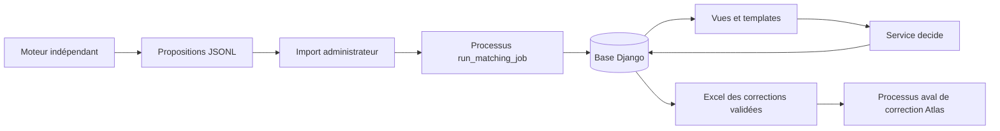
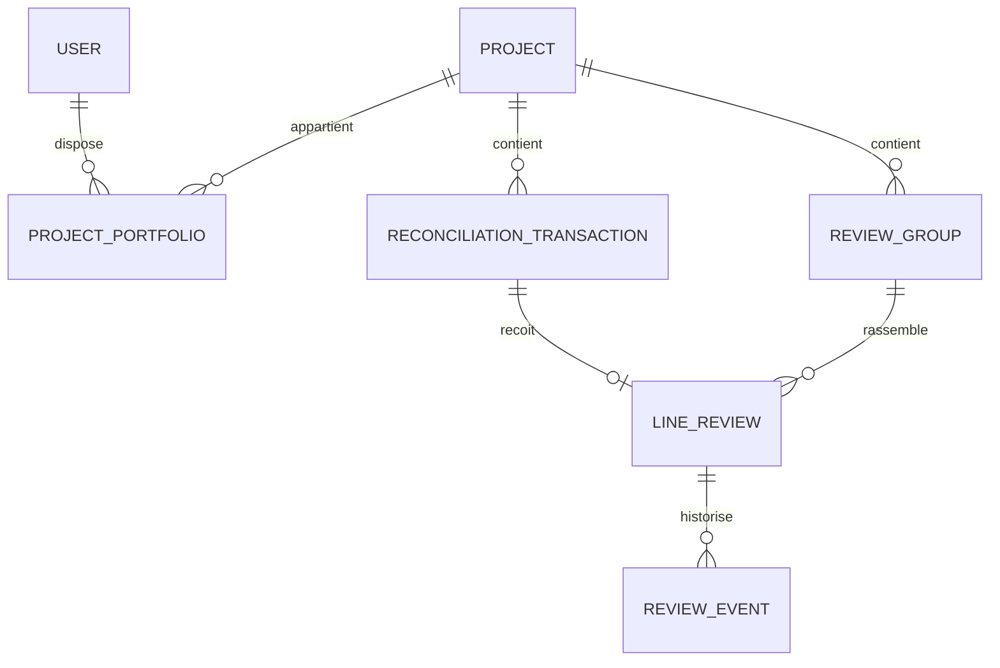

# Application de validation — documentation technique raisonnée

État du code étudié : 18 septembre 2026. Périmètre : application Django du répertoire [app-suivi-reconciliation](../app-suivi-reconciliation), située dans `scriptsRappro`.

Ce document explique les responsabilités, les mécanismes et les arbitrages observables dans l'implémentation. Les raisons présentées relient le code aux besoins exprimés ; elles ne constituent pas une reconstitution de décisions historiques non documentées. Le [document du moteur](documentation_technique_rapprochement.md) décrit le calcul des propositions.

## 1. Traduction technique des spécifications

L'application permet au métier de consulter une proposition de rapprochement, examiner ses preuves, décider ligne Atlas par ligne Atlas et exporter les corrections validées. Elle ne télécharge pas les extractions et ne lance pas le moteur de matching.

| Besoin fonctionnel | Réponse technique implémentée | Effet pour l'utilisateur |
| --- | --- | --- |
| Dissocier calcul et validation | Import d'un contrat JSONL produit hors application | Le calcul peut être exécuté par UiPath ou manuellement |
| Importer manuellement en tant qu'administrateur | Formulaire protégé et processus d'import séparé | Le navigateur n'attend pas la fin du chargement en base |
| Travailler par projet | Modèles `Project`, `ProjectPortfolio` et filtrage des QuerySets | Listes, détails et exports sont limités au périmètre autorisé |
| Voir la proposition et les lignes SAGE | `ReviewGroup` avec règle, statut, total et preuves JSON | Les éléments justifiant la proposition sont visibles |
| Décider sur chaque ligne Atlas | Relation un-à-un entre transaction Atlas et `LineReview` | Une décision de groupe ne remplace pas les décisions individuelles |
| Répartir librement un total multiligne | Corrections de montant, pièce, date et statut par ligne | Une répartition métier est possible, avec justification des écarts |
| Garder les sources distinctes des corrections | Source dans `ReconciliationTransaction`, choix dans `LineReview.values` | Un import ne réécrit pas directement les décisions métier |
| Historiser les interventions | `ReviewEvent` créé dans la transaction de décision | Auteur, valeurs, contexte et dérogations sont conservés |
| Relancer les imports | Identités métier, mises à jour et signatures de source | Une décision est préservée mais peut devenir obsolète |
| Corriger Atlas dans un autre processus | Excel des corrections validées et à jour | Le processus aval dispose de valeurs décidées, identifiées par ligne |
| Proposer une interface moderne et utilisable | Templates Django, composants CSS et JavaScript ciblé | Navigation, filtres et formulaires restent cohérents sans architecture SPA |

Trois faits doivent rester distincts : **le moteur propose**, **l'utilisateur décide**, **le processus aval applique les corrections à Atlas**. La troisième opération n'est pas effectuée par cette application.

## 2. Architecture générale : un monolithe web autour de services métier



Django fournit l'authentification, les formulaires, l'ORM, les migrations et le rendu HTML. Cette architecture regroupe les règles d'accès et de validation côté serveur. Pour un outil de revue essentiellement composé de listes, formulaires et historiques, elle évite de maintenir simultanément une API complète, une application JavaScript et deux ensembles de règles de formulaire.

Les responsabilités sont réparties entre applications Django :

| Répertoire | Responsabilité principale |
| --- | --- |
| `accounts/` | Utilisateur et notion d'administrateur global |
| `projects/` | Projets et portefeuilles des utilisateurs |
| `imports_app/` | Dépôt du fichier, suivi du traitement et lancement du processus |
| `reconciliation/` | Sources, propositions, décisions, contrôle métier et export |
| `dashboard/` | Indicateurs sur le périmètre de l'utilisateur |
| `templates/`, `static/` | Présentation, composants visuels et interactions locales |
| `config/` | Configuration Django et routage général |

Les vues traitent HTTP et préparent l'écran. Les services `import_bundle()` et `decide()` portent les invariants métier. Ainsi, une future commande ou API pourra réutiliser ces services sans recopier les règles depuis les templates. Une API devra néanmoins ajouter son propre contrat d'authentification, de validation d'entrée et d'erreur : elle n'existe pas aujourd'hui.

Le moteur et l'application possèdent chacun un package Python nommé `reconciliation`. Ils s'exécutent dans des contextes distincts ; le fichier JSONL est leur interface. Le bon répertoire de lancement évite d'importer le mauvais package.

## 3. Modèle de données : pourquoi séparer ligne, groupe et décision ?

Sources : [modèles de revue](../app-suivi-reconciliation/reconciliation/models.py), [projets](../app-suivi-reconciliation/projects/models.py), [imports](../app-suivi-reconciliation/imports_app/models.py).



### 3.1. `ReconciliationTransaction` : l'identité et les valeurs sources

Ce modèle représente la ligne Atlas et ses champs canoniques : identifiant, projet, année, libellés, tiers, BAP, montants, pièce et date. Il possède une clé métier et une contrainte conditionnelle d'unicité sur projet/année/identifiant source lorsqu'il est renseigné.

La clé évite qu'un réimport crée une nouvelle ligne simplement parce que son ordre a changé dans le fichier. L'année et le projet fournissent un contexte à l'identifiant Atlas. La base conserve cependant **l'état source courant**, pas une copie intégrale immuable de chaque extraction mensuelle.

Le modèle conserve également des champs du parcours historique de correction. Cette compatibilité évite une migration destructive ; ces anciens champs ne définissent pas le nouveau parcours de revue.

### 3.2. `ReviewGroup` : la proposition commune

Le groupe porte la clé transmise par le moteur, le projet, la règle, le statut de matching, le total SAGE et les preuves. Il possède une version.

Stocker ces informations une seule fois évite de recopier un total de groupe dans chaque ligne comme s'il s'agissait d'une allocation individuelle. Un groupe Atlas de trois lignes pour un total SAGE de 300 € ne signifie pas que chacune doit recevoir 300 €.

`evidence` est un `JSONField` contenant les candidats et leurs lignes SAGE. Ce choix conserve la structure du contrat moteur sans créer une table pour chaque colonne SAGE. Il facilite l'affichage des preuves, mais rend les analyses transversales SQL et les contraintes de schéma moins simples qu'avec des écritures SAGE normalisées en tables. La validation du contenu importé reste donc importante ; le `JSONField` n'impose pas à lui seul un schéma métier complet.

### 3.3. `LineReview` : une décision par ligne Atlas

La relation `OneToOneField` avec la transaction empêche plusieurs décisions courantes concurrentes pour une même ligne. La relation au groupe fournit son contexte collectif.

La décision contient : état, valeurs de correction, commentaire, signature des sources utilisées, version, auteur et date de mise à jour. Un réimport peut modifier la source ou le groupe sans effacer ce travail. La signature permet ensuite de déterminer si ce travail s'appuie toujours sur les mêmes éléments.

### 3.4. `ReviewEvent` : la mémoire des décisions

Chaque appel réussi au service de décision crée un événement : état et valeurs précédents, nouvelle décision, commentaire, version, photographie des sources pertinentes, avertissements et éventuelle dérogation.

Cette séparation évite de transformer la ligne courante en une suite de colonnes « ancienne valeur 1, ancienne valeur 2 ». L'historique est ajouté au fil des décisions. Il ne constitue toutefois pas un registre cryptographiquement inviolable ni un archivage complet des fichiers Atlas/SAGE.

### 3.5. Relations et contraintes

`PROTECT` sur les relations métier concernées empêche une suppression simple de casser la provenance d'une revue. `SET_NULL` sur l'auteur conserve les événements si le compte est supprimé, tout en perdant alors la relation à ce compte. Les contraintes d'unicité sont imposées par la base : deux requêtes simultanées ne peuvent pas se contenter d'un contrôle préalable en Python.

`Project.save()` normalise le code projet ; `ProjectPortfolio` impose l'unicité utilisateur/projet. Le portefeuille est une relation dédiée parce qu'un utilisateur peut suivre plusieurs projets et un projet plusieurs utilisateurs.

## 4. Classes Django et décorateurs : ce qu'ils apportent concrètement

| Élément | Où / rôle | Problème résolu et limite |
| --- | --- | --- |
| `User(AbstractUser)` | Comptes | Réutilise les mécanismes Django et ajoute les besoins locaux, sans réimplémenter l'authentification |
| `@property is_global_admin` | Comptes | Expose un droit calculé à partir de `is_staff` ou `is_superuser`, sans booléen supplémentaire susceptible de diverger |
| `ReconciliationQuerySet.visible_for(user)` | Modèles métier | Centralise le périmètre de lecture ; les vues doivent effectivement l'utiliser |
| `LineReviewForm(forms.Form)` | Formulaire de décision | Valide modes, dates, décimaux et longueurs avant d'appeler le service |
| `@login_required` | Vues métier | Redirige l'utilisateur non connecté ; ne remplace pas le contrôle d'accès au projet |
| `@administrator` | Vues d'import | Combine authentification et exigence d'administration globale |
| `@wraps` dans ce décorateur | Protection des vues | Préserve le nom et les métadonnées de la fonction enveloppée, utiles au diagnostic et à l'introspection ; ce n'est pas le contrôle de sécurité lui-même |
| `@transaction.atomic` | `import_bundle()` et `decide()` | Valide ou annule l'ensemble d'une opération en base en cas d'exception |
| `@contextlib.contextmanager` | `worker_lock()` | Transforme une fonction avec `yield` en gestionnaire utilisable avec `with`, garantissant la libération du verrou |
| `@require_POST` | Retrait d'un projet du portefeuille | Empêche qu'une simple visite GET modifie le portefeuille |
| `@register.filter` | Filtres de templates | Rend disponibles des fonctions de présentation communes, sans mettre leur logique dans chaque template |
| `@register.simple_tag(takes_context=True)` | `query_replace` | Reconstruit les paramètres de navigation en conservant filtres et contexte |
| `BaseCommand` | Commande d'import | Intègre le worker aux paramètres, à la configuration et aux erreurs des commandes Django |

Un décorateur enveloppe une fonction pour ajouter un comportement commun. Il réduit la duplication, mais son emplacement compte : `@transaction.atomic` sur le service protège aussi un appel depuis une commande, alors qu'une protection limitée à la vue HTTP laisserait les autres appels sans cette garantie.

Les formulaires et services ont des validations complémentaires. Le formulaire traite les entrées HTTP ; le service recontrôle les invariants essentiels, les droits, les versions et la cohérence du groupe. Il ne faut cependant pas considérer le service comme un validateur universel de n'importe quel JSON externe : une future API devra garder une couche de validation d'entrée adaptée.

## 5. Import manuel : de l'envoi du fichier à la publication en base

Sources : [formulaire](../app-suivi-reconciliation/imports_app/forms.py), [vues](../app-suivi-reconciliation/imports_app/views.py), [worker](../app-suivi-reconciliation/imports_app/jobs.py), [service d'import](../app-suivi-reconciliation/reconciliation/review_import.py).

### 5.1. Pourquoi le fichier de propositions JSONL ?

Le format transporte un objet par groupe : version du schéma, clé, projet, règle, statut, total SAGE, preuves et lignes Atlas canoniques. Il se lit progressivement et ne dépend pas de la mise en page Excel. Un dernier objet `complete` annonce le nombre de groupes attendu.

Il ne contient pas toutes les tentatives du moteur ni ses scores détaillés. L'application montre les propositions et preuves reçues. Le journal d'analyse complet reste un artefact séparé du moteur.

### 5.2. Réception HTTP et stockage temporaire

L'administrateur choisit un fichier `.jsonl`. Le formulaire contrôle notamment l'extension et la taille, avec une limite configurée de 5 Go. L'extension n'est pas une preuve de validité : le contenu est contrôlé lors de l'import.

Le gestionnaire d'upload Django écrit sur disque. La vue copie les blocs reçus dans un dossier identifié par l'UUID du traitement et calcule simultanément un SHA-256. Elle vérifie l'espace disponible avec une marge de 1 Go et refuse un second traitement actif.

Ces protections évitent de charger tout le fichier dans la mémoire du serveur et d'écraser le fichier d'un autre import. La marge disque n'est pas une estimation exhaustive : la base, son journal transactionnel et les fichiers temporaires peuvent nécessiter davantage d'espace.

### 5.3. Pourquoi un processus séparé ?

`launch()` démarre une commande Django dans un processus distinct avec l'interpréteur de l'application. L'envoi du formulaire peut ainsi se terminer par une redirection vers le suivi, sans garder une requête HTTP ouverte pendant des minutes.

Le processus reçoit ses sorties dans `worker.log`. Sous Windows, le code utilise `pythonw.exe` lorsqu'il est disponible, `CREATE_NO_WINDOW` et une fenêtre masquée. Cela répond au problème de terminal qui apparaissait lors des imports. Sous les systèmes POSIX, une nouvelle session est créée.

Cette solution évite, à ce stade, d'ajouter un courtier de messages et une infrastructure de workers. En contrepartie, ce n'est pas une file de tâches durable avec reprise et supervision automatiques. Fermer le navigateur n'annule pas l'import ; éteindre la machine l'interrompt.

Le nom `MatchingJob` et la commande `run_matching_job` sont historiques. **Le worker actuel importe le JSONL ; il ne lance pas le moteur Atlas/SAGE.** Les anciens champs Atlas/SAGE et l'état `MATCHING` subsistent pour compatibilité mais ne décrivent plus le parcours actif.

### 5.4. Deux protections contre les exécutions concurrentes

La contrainte conditionnelle sur `MatchingJob.active=True` garantit au plus un traitement déclaré actif dans la base. Elle ferme la fenêtre de course entre deux requêtes HTTP qui auraient toutes deux constaté l'absence de traitement.

`worker_lock()` prend en plus un verrou système sur un fichier : `msvcrt` sous Windows, `fcntl` sous POSIX. Il protège aussi contre deux commandes lancées en dehors du navigateur. Le verrou est libéré à la sortie du `with` et par le système à la fermeture du processus.

Ces mécanismes sont complémentaires : le premier porte le statut applicatif, le second l'exécution réelle. Après un arrêt brutal, le verrou système peut être libéré alors que le statut en base est encore actif.

### 5.5. Intégrité, doublons et import atomique

Le worker recalcule l'empreinte du fichier stocké : si elle diffère de celle calculée à l'envoi, l'import est annulé. Cette empreinte détecte un changement ; elle n'authentifie pas l'émetteur du fichier.

Un fichier ayant exactement le même SHA-256 qu'un traitement déjà réussi devient `DUPLICATE` et n'est pas réappliqué. Il s'agit d'une égalité binaire : une réorganisation du JSON peut changer l'empreinte sans changer le sens métier. Inversement, renvoyer un ancien fichier identique après une campagne plus récente ne force pas un retour arrière : il reste reconnu comme déjà traité.

`import_bundle()` lit ligne par ligne et, dans une transaction :

1. Vérifie la version de schéma et la présence de lignes Atlas.
2. Crée ou retrouve le projet et le groupe ; refuse un groupe utilisé pour un autre projet.
3. Met à jour règle, statut, total et preuves, avec incrément de version lorsque ces éléments changent.
4. Parse les champs canoniques et construit l'identité projet/année/Id.
5. Refuse une ligne Atlas répétée dans le même fichier.
6. Met à jour la source, crée la revue si nécessaire ou la rattache au groupe reçu, sans effacer la décision existante.
7. Vérifie le marqueur final et son compteur ; refuse les données après ce marqueur.

Une erreur à la dernière ligne annule aussi les changements effectués pour la première. La transaction externe du worker enregistre les données et le statut final de réussite ensemble ; la transaction interne du service protège également un appel direct de ce service, au prix d'un niveau transactionnel imbriqué.

Le parseur canonique `_parse_new()` est réutilisé depuis `imports_app.services`. C'est une réutilisation de conversion et de validation, pas une réactivation de l'ancien parcours d'import Excel.

### 5.6. États et supervision

| État | Signification dans le parcours actuel |
| --- | --- |
| `UPLOADING` | Réception et stockage du fichier |
| `QUEUED` | Fichier enregistré, worker à lancer ou à démarrer |
| `IMPORTING` | Contrôle puis chargement des propositions |
| `SUCCESS` | Transaction d'import validée |
| `FAILED` | Erreur détectée et enregistrée |
| `DUPLICATE` | Contenu identique à un import réussi, sans réapplication |

Un petit thread touche un fichier `heartbeat` toutes les dix secondes. Il utilise le système de fichiers plutôt que la base pour rester indépendant de la longue transaction SQL. Au-delà de 120 secondes sans signal, le traitement actif peut être présenté comme potentiellement bloqué. Ce signal n'est ni un pourcentage d'avancement ni une preuve de progression métier.

Le suivi lit la fin du journal, limitée à 24 000 octets. La reprise après interruption est manuelle, avec la commande et l'option `--resume`, après vérification du traitement concerné. Elle relance l'import, elle ne reprend pas au numéro de ligne atteint avant l'arrêt.

## 6. Décider sur une ligne : modes explicites et contrôle du groupe

Sources : [service métier](../app-suivi-reconciliation/reconciliation/review.py), [formulaire](../app-suivi-reconciliation/reconciliation/review_forms.py), [vues](../app-suivi-reconciliation/reconciliation/review_views.py).

### 6.1. Pourquoi `KEEP`, `SET`, `CLEAR` ?

Une valeur vide seule est ambiguë : signifie-t-elle « ne rien changer » ou « effacer » ? Chaque champ modifiable possède donc un mode explicite :

| Mode | Valeur effective | Sens métier |
| --- | --- | --- |
| `KEEP` | Valeur source Atlas courante | Conserver |
| `SET` | Valeur renseignée par l'utilisateur | Remplacer |
| `CLEAR` | Aucune valeur | Effacer explicitement |

`effective()` résout les quatre champs : statut BAP, montant SAGE, numéro de pièce et date comptable. Le choix du mode est conservé dans `LineReview.values`, ce qui permet de distinguer une conservation d'un remplacement par une valeur identique.

Les montants sont traités avec `Decimal` pour effectuer les additions et comparaisons métier en décimal. Les valeurs JSON de correction sont sérialisées, puis reconverties lors des calculs. Le formulaire impose le format attendu ; le service refuse les montants non finis et les dates invalides.

### 6.2. Préremplir sans inventer une répartition

Pour une proposition `MATCHED` sans décision déjà enregistrée, l'écran propose `Comptabilisé`, ainsi que la pièce et la date si les preuves fournissent une valeur unique. Le montant du groupe n'est prérempli que si le groupe comporte une seule ligne Atlas.

Pour plusieurs lignes, le total reste une référence collective. L'utilisateur choisit les montants individuels ; l'application ne prétend pas avoir déduit une répartition que le moteur n'a pas calculée.

### 6.3. États de décision et présentation

`DRAFT` enregistre un travail sans validation définitive ; l'interface évite d'en faire un faux statut moteur et affiche l'absence de décision avec un tiret. `VALIDATED` signifie une décision métier validée. `REJECTED` signifie un refus et exige un commentaire.

Une décision obsolète n'est pas un quatrième état stocké : elle est déduite de la signature des sources. Une ligne peut donc conserver l'état historique `VALIDATED` tout en nécessitant une nouvelle revue et en étant exclue de l'export.

### 6.4. Contrôles lors de la validation

Pour valider, les quatre valeurs effectives doivent être présentes. Zéro est un montant renseigné ; une valeur absente ne l'est pas. `CLEAR` permet de préparer une correction en brouillon, mais ne permet pas de valider une ligne avec l'un de ces champs obligatoire vide.

Le service examine ensuite les allocations des autres lignes du groupe. Une ligne refusée ou une décision devenue obsolète ne fournit pas une allocation fiable. Les contrôles produisent des avertissements si :

- aucun total SAGE de référence n'est disponible ;
- la répartition est incomplète ;
- le total alloué diffère du total SAGE de plus de 0,01 € ;
- le couple pièce/date saisi ne correspond à aucune preuve disponible ;
- le moteur n'a pas proposé de correspondance unique.

Pour `MATCH_CONFIRMED_ATLAS` sans preuve SAGE importée, le couple pièce/date déjà présent dans Atlas sert de référence.

Les avertissements ne bloquent pas définitivement l'utilisateur : la validation explicite et un commentaire non vide permettent une dérogation, historisée. Le service possède un paramètre `acknowledge`; dans l'interface actuelle, le clic sur « Valider » fournit cette confirmation. Il n'existe plus de case d'acceptation séparée dans le formulaire.

Exemple : trois lignes Atlas partagent un total SAGE de 300 €. Une répartition 100/100/100 ou 50/100/150 peut être acceptée. Valider la première ligne avant d'avoir renseigné les autres déclenche un avertissement de répartition incomplète ; le commentaire permet d'avancer. Une répartition finale à 310 € peut également être validée avec justification. C'est une souplesse métier assumée, pas une garantie de stricte égalité comptable.

L'application ne vérifie pas que la pièce saisie librement existe dans SAGE au-delà des preuves importées et n'impose pas que toutes les lignes soient validées en une seule opération.

## 7. Protéger les décisions contre les changements et la concurrence

### 7.1. Signature des sources : « ma décision est-elle encore pertinente ? »

`source_snapshot()` sélectionne les champs Atlas déterminants et le contexte du groupe : clé, règle, statut, total et preuves. Les décimaux sont normalisés à deux décimales ; une simple différence de représentation entre `100` et `100.00` ne doit pas invalider une décision.

`signature()` sérialise ce contexte avec des clés ordonnées puis calcule un SHA-256. À chaque décision, cette signature est enregistrée. `is_current()` compare ensuite la signature enregistrée au contexte courant.

Un nouvel import modifiant une preuve, un montant ou le groupe peut donc rendre la décision obsolète sans la supprimer. L'utilisateur retrouve son travail, mais doit le confirmer sur les nouvelles données. Un changement d'ordre des éléments dans une liste de preuves peut aussi changer la signature : l'ordre des clés JSON est stabilisé, pas nécessairement celui de toutes les listes.

La signature ne couvre pas chaque champ canonique : elle matérialise un choix de dépendances métier. Ajouter un champ déterminant pour la validation implique de mettre à jour `source_snapshot()` et les tests. Elle ne sert pas à prouver l'authenticité de l'extraction.

### 7.2. Versions : « quelqu'un a-t-il travaillé depuis l'ouverture de ma page ? »

Le formulaire transporte trois éléments cachés : version de la ligne, version du groupe et signature des sources. Le serveur les compare à l'état courant avant toute écriture. Ces champs ne sont pas considérés comme dignes de confiance parce qu'ils sont cachés : ils sont confrontés aux valeurs recalculées et aux droits de l'utilisateur.

Une modification de la même ligne fait évoluer sa version. Une décision sur une autre ligne du groupe fait évoluer la version du groupe, car elle peut changer le solde à répartir. Un changement des sources est détecté par la signature. Ces contrôles répondent donc à trois types de péremption différents.

Exemple : Alice et Bob ouvrent deux lignes d'un même groupe. Alice valide une allocation ; la version du groupe augmente. Lorsque Bob soumet son ancien écran, le service lui demande de recharger pour décider à partir du nouveau solde.

### 7.3. Transaction et verrouillage

`decide()` ouvre une transaction et verrouille d'abord le groupe avec `select_for_update()`, puis la ligne. Il vérifie que le rattachement au groupe n'a pas changé, contrôle les droits et les versions, applique la décision, incrémente les versions et écrit l'événement.

L'atomicité garantit qu'une décision et son historique sont validés ensemble. Le verrou de groupe vise à empêcher deux répartitions incompatibles de se fonder simultanément sur le même état, sur un moteur de base offrant le verrouillage de lignes attendu.

**SQLite ne fournit pas le même verrouillage de lignes que PostgreSQL pour `select_for_update()`.** Les comparaisons de versions restent utiles, mais ne rendent pas les garanties de concurrence des deux bases équivalentes. Sous SQLite, des écritures simultanées peuvent se traduire par une erreur de verrouillage plutôt que par une attente et une erreur métier propre.

## 8. Nouveaux imports : ce qui est conservé, ce qui ne l'est pas

L'import met à jour les sources courantes et les propositions, conserve les décisions, et laisse les signatures déterminer leur actualité. Cette stratégie évite de demander au métier de recommencer systématiquement toutes les validations identiques.

Elle n'est pas encore une gestion complète de campagnes :

- `MatchingJob` représente une exécution d'import, pas une photographie complète consultable d'un mois donné.
- Une ligne absente du nouvel import n'est pas automatiquement archivée ou supprimée.
- Les regroupements peuvent évoluer ; les revues reçues sont rattachées au nouveau groupe, sans mécanisme général de clôture de tous les anciens groupes.
- Les sources courantes sont mises à jour ; les événements conservent le contexte des décisions, pas toutes les versions successives de chaque extraction.
- La clé de groupe fournie par le moteur est fondée sur projet et identifiants Atlas ; elle n'intègre pas une campagne mensuelle.

Ces limites sont à traiter avant de considérer le système comme un archivage mensuel exhaustif. Une évolution vers des campagnes devrait définir l'identité de campagne, les règles d'absence, la conservation des preuves et la portée des exports avant de modifier les modèles.

## 9. Accès, autorisations et séparation des périmètres

`visible_for(user)` renvoie aucun enregistrement pour un utilisateur anonyme, l'ensemble pour un administrateur global, et les projets du portefeuille pour les autres. Les vues de liste, détail et export s'appuient sur ce périmètre. Le service de décision contrôle à nouveau la visibilité de la transaction pour ne pas dépendre uniquement du filtrage de la page précédente.

L'import et ses téléchargements sont réservés aux administrateurs. Les fichiers téléchargeables sont choisis dans une liste de noms autorisés au sein du dossier du traitement ; un chemin arbitraire fourni dans l'URL n'est pas ouvert.

Le parcours de portefeuille permet actuellement à un utilisateur d'ajouter à son propre portefeuille un projet actif dont il connaît le code. Il ne faut donc pas interpréter ce modèle comme une attribution exclusivement administrée de projets confidentiels. Renforcer cette politique serait une évolution fonctionnelle des habilitations.

La protection CSRF de Django couvre les formulaires POST ; les templates échappent normalement les contenus textuels. L'URL de retour du détail est limitée à la route relative de la liste métier afin de conserver les filtres sans accepter une redirection vers un site arbitraire.

Les modèles de source et de revue exposés en lecture seule dans l'administration évitent de contourner les services métier par une modification banale dans l'admin. Cela ne transforme pas la base en stockage immuable face à un accès SQL direct.

## 10. Interface : les choix techniques au service de la revue

La [documentation de refonte UX](../app-suivi-reconciliation/docs/refonte-ui-ux.md) détaille les écrans. Le socle visuel est dans [workspace.css](../app-suivi-reconciliation/static/css/workspace.css), avec des comportements dans [workspace.js](../app-suivi-reconciliation/static/js/workspace.js) et `app.js`.

### 10.1. Templates et composants communs

Les composants de KPI, décision, pagination et historique évitent que chaque page réinvente couleurs, libellés et espacements. Les variables CSS centralisent la palette, les surfaces et les dimensions. Le détail distingue la source Atlas, la proposition/preuve SAGE et la correction métier pour ne pas mélanger les trois niveaux de vérité.

Le rendu côté serveur conserve les contrôles et droits dans Django. JavaScript ajoute des interactions ciblées : modes de correction, aperçu du solde, sélection de fichier, navigation latérale et actualisation du suivi. Le calcul affiché dans le navigateur facilite la saisie ; le calcul `Decimal` du service reste la référence lors de l'enregistrement.

### 10.2. Navigation sur des volumes importants

La liste est paginée côté serveur, avec 25, 50 ou 100 lignes, 50 par défaut. Elle propose recherche et filtres projet/règle/décision/statut moteur. Le filtre initial `MATCHED` présente d'abord les propositions de correspondance ; il n'efface pas les cas ambigus ou sans correspondance, accessibles en changeant le filtre.

`select_related()` charge les relations utilisées dans l'écran pour éviter une requête SQL supplémentaire par ligne. Les totaux et cardinalités des groupes de la page sont agrégés ensemble. Les menus de filtres restent fondés sur le périmètre autorisé, plutôt que sur une liste globale de projets.

`Paginator` limite les données affichées mais doit compter le résultat. Les recherches `icontains` sur plusieurs champs peuvent rester coûteuses sur une très grande base ; la pagination ne remplace pas une stratégie d'indexation et de recherche adaptée.

### 10.3. Lisibilité et interactions

Les tableaux conservent leur structure avec défilement horizontal contenu. Le détail se réorganise sur petit écran. Les montants utilisent une présentation française, en distinguant clairement absence et zéro. Les informations ne reposent pas uniquement sur une couleur : des libellés accompagnent les états.

La navigation mobile gère le focus et la fermeture au clavier. Les paramètres de recherche sont conservés lors du retour depuis une ligne. L'historique présente des changements métier plutôt qu'un JSON brut ; l'écran charge les 50 événements les plus récents, sans supprimer les plus anciens de la base.

## 11. Fichier de conservation : un export de corrections validées

`conservation_export()` sélectionne les revues `VALIDATED` visibles par l'utilisateur, éventuellement pour un projet, puis exclut celles dont la signature n'est plus actuelle. `effective()` fournit les valeurs finales à appliquer.

Le classeur contient :

| Identification | Correction et traçabilité |
| --- | --- |
| Id, Code projet, Année | Statut BAP, Total charges SAGE (€), N° pièce SAGE, Date comptable |
|  | Commentaire, Version, Signature source |

Le fichier ne reprend pas toutes les colonnes de l'extraction Atlas : c'est un jeu de corrections à joindre à cette extraction avec une clé métier contrôlée. Il ne constitue pas non plus un export de toutes les tentatives de rapprochement.

`Workbook(write_only=True)` limite la mémoire des cellules, et les textes sont forcés au type texte pour éviter les formules issues de données. La réponse HTTP finale contient cependant le classeur produit ; ce n'est pas un téléchargement entièrement diffusé au fil de l'écriture depuis un stockage externe.

Il n'existe pas de verrou de publication exigeant que toutes les lignes d'un groupe soient validées. Une ligne validée et actuelle peut être exportée alors que d'autres restent à traiter, y compris lorsqu'une dérogation a été justifiée. Le processus aval doit donc savoir s'il accepte des corrections partielles.

L'application ne réalise pas la jointure finale avec le JDD, ne modifie pas directement Atlas et ne vérifie pas la réussite de cette application aval. La signature exportée aide à la traçabilité, mais n'effectue pas ces contrôles à elle seule.

## 12. Exploitation, performances et points de vigilance constatés

### 12.1. Répertoire et commandes

Depuis `scriptsRappro/app-suivi-reconciliation` :

```powershell
uv run python manage.py runserver
```

Le serveur de développement permet les essais locaux. Une exploitation partagée permanente nécessite une configuration de déploiement appropriée, distincte de cette commande de test.

Le worker utilise la commande suivante ; la reprise est une action d'exploitation sur un UUID existant, pas une commande à lancer en parallèle sans diagnostic :

```powershell
uv run python manage.py run_matching_job <UUID_DU_TRAITEMENT> --resume
```

Les paramètres sont centralisés dans [settings.py](../app-suivi-reconciliation/config/settings.py). SQLite est le choix local par défaut ; une configuration PostgreSQL est prévue via les variables d'environnement. Les traitements conservent leurs fichiers sous `var/matching` par défaut. Aucun nettoyage automatique complet de cet historique de fichiers n'est décrit par le parcours actuel.

### 12.2. Pourquoi l'erreur SQLite « database is locked » peut survenir

L'import est une longue transaction d'écriture. Avec SQLite, les accès concurrents de l'application — notamment les écritures de session ou les décisions — peuvent entrer en conflit avec cette transaction. Lors du diagnostic réalisé sur cette installation, le journal SQLite était en mode `delete` et un import avait finalement réussi malgré une erreur HTTP de consultation.

L'état du traitement et ses journaux sont donc plus informatifs qu'une seule page d'erreur. Le mode WAL n'a pas été activé par cette implémentation. WAL pourrait améliorer certaines interactions lecture/écriture, mais ne donnerait pas à SQLite plusieurs écrivains simultanés ni le verrouillage de lignes de PostgreSQL.

Pour une utilisation concurrente soutenue, PostgreSQL est une évolution cohérente avec les transactions et `select_for_update()` déjà utilisés. Il faut la tester sur les imports, décisions simultanées et reprises ; changer simplement une variable de connexion ne constitue pas une validation de migration.

### 12.3. Où se trouvent les coûts ?

| Opération | Coût principal | Mécanisme présent / évolution possible |
| --- | --- | --- |
| Upload | Transfert et écritures disque | Blocs progressifs, pas de fichier complet en mémoire |
| Vérification du fichier | Relecture intégrale pour SHA-256 | Détecte une modification après envoi ; ajoute un parcours disque |
| Import | Nombreuses opérations ORM et longue transaction | Lecture JSONL progressive ; pas d'import massif par `bulk_create` généralisé |
| Suivi | Consultation répétée de la base et du journal | Fin du journal seulement, signal de vie sur fichier |
| Liste | Recherche, comptage et relations | Pagination, `select_related`, agrégats par page |
| Tableau de bord | Contrôle d'actualité des décisions | Agrégations SQL pour certains compteurs ; signatures des décisions revues calculées côté Python |
| Export | Résolution des valeurs, signatures, création XLSX | Itération des lignes et cellules séquentielles ; requête HTTP encore synchrone |

La lecture progressive du JSONL ne signifie pas une mémoire strictement constante : l'import conserve notamment un ensemble des clés déjà rencontrées pour détecter les doublons. Les preuves JSON, les objets ORM et les données de la base ont également un coût.

Découper l'import en transactions par lots accélérerait parfois la disponibilité, mais ferait perdre le contrat « tout ou rien » actuel. Une optimisation préservant cette garantie pourrait passer par des tables de préparation puis une publication finale. Ce mécanisme n'est pas implémenté.

## 13. Héritage conservé et périmètre non implémenté

L'ancien parcours a laissé des modèles, champs, services et tests : `ImportBatch`, `TransactionObservation`, `CorrectionHistory`, certains champs de suggestion/correction et le nom `MatchingJob`. Ils expliquent la présence de code qui n'est plus le point d'entrée du parcours actuel. Une suppression demanderait une analyse de migrations et de conservation des données, pas simplement l'effacement des classes.

Les éléments suivants ne doivent pas être supposés disponibles : import par API, dossier surveillé, planification mensuelle intégrée, exécution du moteur dans l'application, campagnes immuables, allocation automatique détaillée, mise à jour directe d'Atlas, reprise automatique après panne, garantie de groupe entièrement validé avant export.

Une prochaine évolution devrait définir le besoin avant de choisir l'outil : API pour automatiser l'entrée, worker supervisé pour les reprises, PostgreSQL pour la concurrence, campagnes pour l'historisation mensuelle. Ces choix répondent à des problèmes différents et ne sont pas interchangeables.

## 14. Tests et règles de maintenance

Les suites sont organisées autour des responsabilités : [revue métier](../app-suivi-reconciliation/reconciliation/test_review.py), [interface](../app-suivi-reconciliation/reconciliation/test_ui.py), [imports en arrière-plan](../app-suivi-reconciliation/imports_app/test_jobs.py), [migrations](../app-suivi-reconciliation/reconciliation/test_migrations.py), et tests de projets/imports historiques.

Les cas essentiels à préserver sont : droits par périmètre ; import incomplet annulé ; réimport sans perte des décisions ; empreinte de fichier contrôlée ; conflit de versions détecté ; décision obsolète exclue de l'export ; valeurs KEEP/SET/CLEAR distinctes ; justification des refus et dérogations ; montants du groupe non dupliqués en préremplissage ; décision et historique atomiques.

Pour ajouter un champ modifiable, intervenir de manière cohérente dans `FIELDS`, le formulaire, `effective()`, la signature si nécessaire, la vue, le template, l'historique et l'export. Pour changer la logique d'import, préserver les identités métier et documenter les effets sur les décisions existantes. Pour changer les habilitations, couvrir à la fois les listes, les accès directs au détail, les services et les exports.

Les tests ne remplacent pas des essais de concurrence sur la base de production envisagée. Cette documentation a été rédigée à partir du code sans modifier les données applicatives ni relancer les imports réels.
