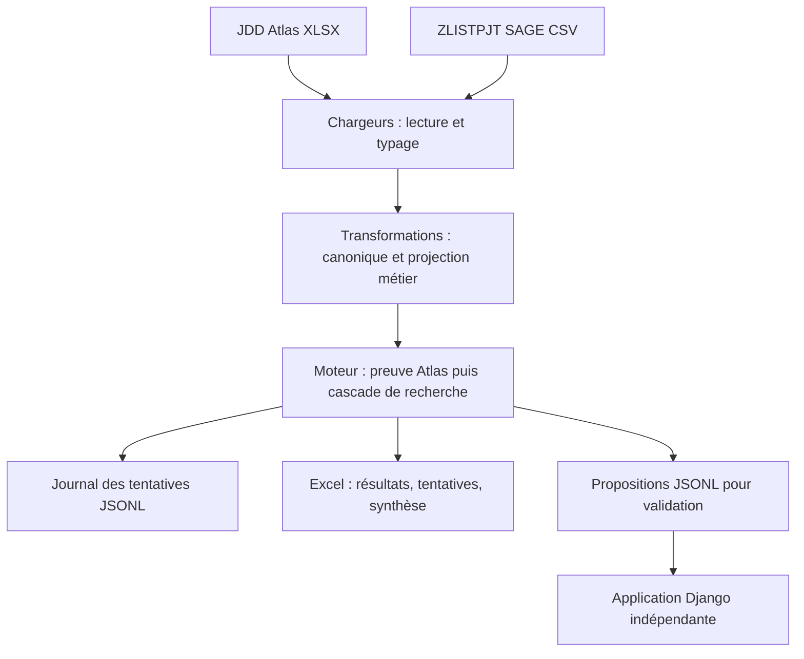

# Moteur Atlas / SAGE — documentation technique raisonnée

**Évolution du 24 septembre 2026 :** le [guide des multiples Atlas, affectations et exports](multiples_atlas_affectations_export.md) décrit le contrat JSONL v3, le contrôle des Comptabilisé, la projection des validations et le nouvel audit. Il complète et, pour ces points, remplace les règles antérieures de ce document.

État du code étudié : 18 septembre 2026. Document destiné aux développeurs, mainteneurs et responsables fonctionnels souhaitant comprendre les arbitrages de l'implémentation.

**Évolution du 20 septembre 2026 :** le [contrat de campagne JSONL v2](campagnes_rapprochement.md)
remplace le contrat v1 décrit en section 9.2. Il ajoute un en-tête de campagne et l'inventaire
minimal de toutes les lignes Atlas, puis les propositions et un double compteur de fin.
La cascade de matching et les sorties Excel d'analyse restent celles décrites ici.

Le paramètre facultatif `--year` filtre désormais les deux sources avant le matching :
`Année` côté Atlas et année de `Date comptable` côté SAGE. Voir le
[guide du filtre annuel](filtre_annuel_et_portefeuilles.md) pour les contrôles, compteurs et effets sur les campagnes.

Les justifications ci-dessous expliquent la conception observable dans le code et les besoins auxquels elle répond. Elles ne prétendent pas reconstituer des décisions historiques qui n'auraient pas été consignées. Les évolutions envisagées sont distinguées des mécanismes effectivement présents.

## 1. Traduction technique des spécifications

Le moteur transforme deux extractions hétérogènes en propositions explicables, sans modifier les fichiers sources. La validation humaine appartient à une application séparée, décrite dans la [documentation de l'application](documentation_technique_application.md).

| Besoin fonctionnel | Traduction technique | Conséquence |
| --- | --- | --- |
| Exploiter un JDD Atlas réparti sur plusieurs feuilles | Chargeur XLSX qui empile les feuilles valides | La limite d'une feuille Excel ne limite pas la taille du jeu Atlas chargé |
| Exploiter ZLISTPJT SAGE | Chargeur CSV avec détection du séparateur et repli d'encodage | Les particularités du fichier restent confinées à la lecture |
| Rechercher les lignes « Envoyé SAGE » | Sélection sur le statut normalisé avant recherche | Les autres lignes sont restituées hors périmètre dans Excel |
| Reconnaître une preuve déjà présente dans Atlas | Contrôle pièce + date + montant SAGE avant regroupement | Une ligne peut être confirmée sans revendiquer de ligne SAGE |
| Rapprocher des groupes de lignes | Agrégation sur projet, libellé, tiers, BAP/référence | Le montant et la cardinalité deviennent des propriétés du groupe |
| Accepter des libellés proches | Similarité RapidFuzz après filtrage structuré et financier | Le fuzzy ne cherche jamais dans tout SAGE sans restriction |
| Ne pas décider arbitrairement | Conservation des candidats plausibles et contrôles de concurrence | Plusieurs candidats ou preuves incompatibles produisent une ambiguïté |
| Comprendre les tentatives | Journal JSONL progressif et feuille Excel dédiée | Une décision peut être reliée aux contrôles effectivement exécutés |
| Alimenter une application indépendante | Contrat JSONL de propositions, versionné | Le moteur n'a aucune dépendance à la base Django |
| Traiter plus d'un million de lignes Atlas | pandas, préfiltrage, index de candidats et export séquentiel | Les coûts sont réduits, mais les sources restent chargées en mémoire |

## 2. Architecture et séparation des responsabilités



Le point d'entrée [main.py](../reconciliation/main.py) orchestre les étapes. Il ne contient pas les règles de rapprochement : celles-ci sont dans `matching/`. Les chargeurs connaissent les noms et formats des sources ; les transformations construisent les champs techniques ; les exporteurs connaissent les formats de restitution.

Cette séparation permet, par exemple, de corriger un encodage CSV sans changer la logique de matching, ou d'ajouter un export sans modifier les critères de décision. Elle permet aussi de tester une règle avec de petits DataFrames, sans fabriquer systématiquement un classeur complet.

La conception utilise principalement des fonctions : la lecture, la normalisation et la sélection de candidats sont des transformations de données. Les classes sont réservées aux objets qui possèdent un contrat ou un état utile : configuration, résultat, index, journal et catégories d'erreurs. Il n'y a pas de hiérarchie de classes de règles à maintenir pour une cascade encore courte et explicite.

## 3. Lire les extractions sans confondre absence, zéro et identifiant

Sources : [Atlas](../reconciliation/loaders/atlas.py), [SAGE](../reconciliation/loaders/sage.py), [outils de typage](../reconciliation/loaders/common.py), [configuration](../reconciliation/config.py).

### 3.1. Atlas : lecture multifeuille et déduplication

`load_atlas()` lit d'abord les en-têtes de chaque feuille et vérifie les colonnes minimales `Id` et `Code projet`. Une feuille non conforme est ignorée avec avertissement. Les feuilles valides non vides sont ensuite concaténées. Un identifiant vide interdit le chargement.

La lecture initiale en chaînes protège les identifiants contre une conversion numérique implicite. Elle ne peut cependant pas recréer un zéro initial déjà perdu dans le fichier source. `keep_default_na=False` évite de considérer automatiquement certaines chaînes textuelles comme des valeurs absentes ; la chaîne vide est explicitement traitée comme manquante.

Après typage, la déduplication conserve **le premier exemplaire de chaque `Id`**, sur l'ensemble des feuilles. Ce choix évite de compter deux fois une ligne Atlas présente dans plusieurs feuilles. Sa limite est importante : deux lignes différentes portant le même identifiant ne sont pas fusionnées ni arbitrées par date ; la première gagne. L'unicité globale de `Id` est donc une hypothèse du chargeur, plus forte que la clé projet/année/Id utilisée dans l'application.

### 3.2. SAGE : préserver les écritures distinctes

`load_sage()` vérifie les colonnes `Projet`, `Numéro pièce` et `Date comptable`. Le séparateur est détecté parmi `;` et `,`. La lecture essaie UTF-8 avec BOM, puis Windows-1252 en cas d'erreur de décodage avec l'encodage par défaut. Les lignes CSV mal formées sont des erreurs, pas des lignes silencieusement ignorées.

La déduplication SAGE porte sur **toutes les colonnes sources avant conversion**. Plusieurs écritures partageant une pièce ou un projet restent donc distinctes. Deux représentations textuelles différentes d'un nombre ne sont pas considérées comme un doublon strict. À l'inverse, deux écritures légitimes entièrement identiques dans l'extraction seraient dédupliquées : le modèle suppose qu'un doublon intégral est un doublon d'extraction.

### 3.3. Pourquoi les types pandas nullables ?

`StringDtype`, `Int64` et `Float64` permettent de conserver une valeur absente avec un type cohérent. Un montant absent n'est pas remplacé par zéro ; une année absente ne devient pas artificiellement une année valide. Les dates sont converties en valeurs datetime et les nombres prennent en charge les espaces et conventions décimales configurées.

Les conversions invalides sont signalées dans les informations de typage et deviennent manquantes. Ce n'est pas un rejet systématique du fichier : les contrôles suivants décident si cette absence empêche le rapprochement. Les infinis sont exclus. Les erreurs de structure, elles, interrompent le traitement.

Les classes `LoaderError`, `AtlasLoaderError` et `SageLoaderError` donnent une catégorie exploitable aux erreurs. L'héritage permet au CLI de traiter ensemble les erreurs de lecture tout en conservant leur origine. `raise ... from exc` préserve la cause pour le diagnostic.

## 4. Normalisation : deux niveaux pour deux responsabilités

Sources : [canonique commun](../reconciliation/transformations/common.py) et [projection de matching](../reconciliation/transformations/matching.py).

`build_canonical()` copie les données et ajoute les champs techniques communs. Les colonnes sources sont conservées : on peut restituer leur valeur et comprendre l'origine d'une donnée. Les collisions avec des noms canoniques existants sont refusées pour éviter un écrasement silencieux.

`normalize_text()` retire les espaces de bord, remplace les espaces insécables et traite le vide comme une absence. Les identifiants concernés sont mis en majuscules. Le nettoyage reste prudent : il ne supprime pas arbitrairement la ponctuation ou les séparateurs. Les libellés ne subissent pas une uniformisation agressive ; l'égalité exacte porte sur leur représentation normalisée effectivement produite.

`prepare_matching()` ajoute ensuite les choix métier spécifiques :

| Champ technique | Atlas | SAGE |
| --- | --- | --- |
| `matching_reference` | `N° BAP (SAGE)` | `Référence` |
| `third_party_code` | `Code tiers SAGE` | `Code Tiers - Tiers doc Orig` |
| `matching_amount` | `Total charges projet (€)` | `Charges (Dépenses)` |
| `confirmed_amount` | `Total charges SAGE (€)` | Non utilisé |
| `source_status` | `Statut BAP` | Non utilisé |

La séparation évite qu'un champ canonique générique `amount` impose prématurément un sens métier. Le choix du montant de comparaison est explicite dans la configuration du matching.

`source_position` identifie une ligne par sa position après chargement/déduplication, indépendamment de l'index pandas. Cet index peut être dupliqué ; `Id` peut aussi ne pas être disponible côté SAGE. Les positions permettent de revenir aux lignes réellement utilisées. Ce ne sont pas des numéros de lignes physiques du CSV ou du classeur d'origine.

## 5. Les classes centrales et les raisons de leur existence

| Élément | Problème résolu | Avantage et contrepartie |
| --- | --- | --- |
| `MatchingConfig` avec `@dataclass(frozen=True)` | Regrouper et contrôler les paramètres d'une exécution | Construction lisible, configuration immuable après création ; les variantes doivent être construites explicitement |
| `MatchingConfig.__post_init__()` | Empêcher des seuils incohérents ou des valeurs non finies | Échec au démarrage plutôt qu'un résultat surprenant après un traitement long |
| `frozenset` pour `auto_account_rules` | Représenter un ensemble de règles autorisées sans mutation | Test d'appartenance simple ; aucune règle expérimentale n'est autorisée automatiquement par défaut |
| `MatchResult` avec `@dataclass` | Stabiliser le contrat d'un résultat riche | Champs déclarés, valeurs par défaut, conversion avec `asdict()` ; objet mutable pour les contrôles finaux |
| `CandidateIndex` | Éviter de reparcourir tous les groupes SAGE à chaque groupe Atlas | Conserve des blocs triés réutilisables ; consomme de la mémoire pour cet index |
| `Trace` avec `__enter__` / `__exit__` | Garantir la fermeture et la finalisation du journal | Le `with` lie la durée de vie du fichier au traitement, y compris lors d'une exception |

Une `dataclass` génère notamment le constructeur à partir des champs. Elle réduit le code répétitif ; elle n'est pas, à elle seule, une validation de types à l'exécution. D'où les vérifications explicites de `__post_init__()` et des fonctions métier.

`MatchResult` reste mutable parce qu'un candidat retenu localement peut être invalidé après examen des autres groupes Atlas. Figer le résultat trop tôt compliquerait cette seconde passe ou donnerait une impression erronée de décision définitive.

Sources : [modèles](../reconciliation/matching/models.py), [index et agrégats](../reconciliation/matching/aggregated.py), [journal](../reconciliation/matching/trace.py).

## 6. Déroulement exact du rapprochement

Source principale : [engine.py](../reconciliation/matching/engine.py).

### 6.1. Sélection et preuve locale Atlas

Seules les lignes dont le statut est `Envoyé SAGE` entrent dans le moteur. Pour chacune, la présence simultanée de pièce comptable, date comptable et montant SAGE suffit à produire `MATCH_CONFIRMED_ATLAS`.

Cette vérification intervient **avant toute agrégation**. Elle ne contrôle pas que le montant projet est égal au montant SAGE et ne consomme aucune ligne de l'extraction SAGE. Le nom désigne une preuve déjà présente dans Atlas, pas une recherche réussie dans SAGE.

### 6.2. Préfiltrage SAGE : restriction sûre du périmètre de recherche

Pour les lignes Atlas encore à traiter, le moteur extrait les triplets `(projet, tiers, BAP)`. Il conserve toutes les lignes SAGE dont `(projet, tiers, référence)` appartient à ces triplets.

Il ne filtre ici ni sur le libellé, ni sur le montant, ni sur l'année. Tous les libellés et montants d'un bloc autorisé restent disponibles pour les étapes suivantes. Cette optimisation respecte les règles actuelles, puisque toutes exigent ce même triplet. Une future règle autorisant un tiers ou un BAP différent devra revoir ce préfiltrage.

Avant restriction, `restrict_sage()` calcule la numérotation globale des groupes. Ainsi, activer le préfiltrage ne renumérote pas arbitrairement les candidats restants et leurs positions sources restent globales. La numérotation est stable par rapport à ce filtrage, **pas nécessairement entre deux extractions réordonnées**.

Le préfiltrage diminue les agrégats et les candidats à manipuler. Il ne dispense pas de lire le CSV complet ni de préparer ses colonnes.

### 6.3. Regroupement : les quatre champs sont bien utilisés

`aggregate()` groupe séparément Atlas restant et SAGE retenu sur :

```text
(project_code, label, third_party_code, matching_reference)
```

Le libellé fait partie de la clé. **Il n'y a pas de sélection du premier libellé parmi toutes les lignes d'un triplet.** Deux libellés différents pour un même projet/tiers/BAP créent deux groupes. Le triplet seul sert ensuite à réunir ces groupes dans un bloc de recherche.

Exemple : deux lignes Atlas de libellé `Transport` à 60 et 40 deviennent un groupe de 100, cardinalité 2. Une ligne `Hôtel` du même triplet reste dans un autre groupe. Si SAGE contient une seule ligne `Transport` à 100, le groupe Transport peut relever de `MATCH_AMOUNT`, car le montant et la clé complète correspondent mais pas la cardinalité.

Les agrégats conservent les identifiants, positions, pièces et dates sources. Si un montant manque sur une ligne, la somme du groupe est invalidée : une somme partielle de 100 + inconnu ne doit pas être présentée comme un total fiable de 100. `dropna=False` garde les groupes incomplets pour pouvoir les expliquer, au lieu de les perdre silencieusement.

### 6.4. Index structuré puis recherche par montant

`CandidateIndex` construit un dictionnaire par triplet. Dans chaque bloc, les groupes SAGE aux montants complets sont triés par montant. `bisect_left` et `bisect_right` isolent l'intervalle autour du montant Atlas.

Pour un bloc de taille `k` et `m` candidats dans l'intervalle, la recherche a un coût de l'ordre de `log(k) + m`, après construction et tri de l'index. Cela évite une comparaison de chaque groupe Atlas à chaque groupe SAGE.

La tolérance par défaut est absolue : **0,01 €**. Une marge de `1e-9` traite les résidus de représentation flottante au bord de la tolérance ; elle ne constitue pas une seconde tolérance métier. Le moteur utilise des flottants pandas, tandis que l'application utilise `Decimal` pour les montants saisis. Une migration du moteur vers des centimes entiers serait une évolution distincte, avec règles d'arrondi à spécifier.

### 6.5. Cascade de règles

| Ordre | Règle | Conditions supplémentaires après triplet et montant compatibles |
| --- | --- | --- |
| 1 | `MATCH_EXACT` | Même clé complète et même nombre de lignes |
| 2 | `MATCH_AMOUNT` | Même clé complète, mais nombre de lignes différent |
| 3 | `MATCH_FUZZY_HIGH` | Libellés comparables et meilleur score plausible ≥ 0,95 |
| 4 | `MATCH_FUZZY_REVIEW` | Candidats plausibles ≥ 0,85, sans score atteignant 0,95 |
| 5 | `MATCH_WITHOUT_LABEL` | Candidats structurés et financiers restants, si cette étape est activée |

Le fuzzy utilise par défaut `token_set_ratio` de RapidFuzz, ramené à `[0, 1]`. Il compare des ensembles de mots ; des libellés avec des mots supplémentaires peuvent donc obtenir un score élevé. Ce score mesure une ressemblance textuelle, pas la probabilité qu'une écriture soit la bonne. La méthode `ratio` est également disponible par configuration Python.

Tous les candidats atteignant le seuil de revue sont conservés. Exemple : des scores de 0,98 et 0,87 produisent **deux candidats plausibles**, donc une ambiguïté finale, même si le meilleur appartient à la catégorie haute. Le moteur ne choisit pas arbitrairement le maximum.

La cascade s'arrête à la première règle ayant des candidats. Elle ne passe pas à une règle plus permissive pour contourner une ambiguïté. L'absence de libellé empêche les règles qui le nécessitent, mais peut permettre `MATCH_WITHOUT_LABEL`.

### 6.6. Contrôles après sélection

`apply_candidates()` puis `resolve_shared_candidates()` vérifient :

1. **Unicité du candidat** : plusieurs groupes SAGE plausibles donnent `MULTIPLE_CANDIDATES`.
2. **Compatibilité des preuves** : plusieurs pièces distinctes ou plusieurs dates distinctes dans le groupe donnent `INCOMPATIBLE_SAGE_EVIDENCE`.
3. **Complétude des preuves** : une pièce ou date absente sur certaines lignes impose une revue et interdit le statut cible automatique.
4. **Exclusivité entre groupes Atlas** : si plusieurs groupes revendiquent un même candidat SAGE, tous deviennent ambigus avec `SAGE_CANDIDATE_SHARED`.

Ce dernier contrôle est une seconde passe globale. Il évite que l'ordre des lignes donne un avantage au premier groupe traité. Il porte aussi sur les candidats conservés dans des résultats déjà ambigus.

## 7. Statut, règle, confiance et statut cible : quatre notions distinctes

| Champ | Question à laquelle il répond |
| --- | --- |
| `match_status` | Le résultat est-il `MATCHED`, `AMBIGUOUS` ou `UNMATCHED` ? |
| `match_rule` | Quelle règle explique le résultat, ou quelle issue finale remplace cette règle ? |
| `confidence` | Quel indicateur conventionnel de confiance accompagne cette règle ? |
| `requires_review` | Le moteur estime-t-il une revue nécessaire ? |
| `target_status` | Peut-il proposer automatiquement `Comptabilisé` selon sa configuration ? |
| `reason` | Quel motif technique précis explique la décision ? |

Les confiances par défaut sont 1 pour preuve Atlas/exact, 0,90 pour montant, le score textuel pour fuzzy, 0,70 sans libellé, aucune confiance pour ambigu. **Ce ne sont pas des probabilités calibrées.**

Une règle exacte avec preuve SAGE complète peut proposer `Comptabilisé`. Les règles expérimentales demandent une revue par défaut ; `auto_account_rules` permet de configurer certaines propositions de statut cible, sans supprimer tous les indicateurs de revue. Aucune proposition ne modifie le JDD.

`MATCHED` ne signifie donc ni « validé par un utilisateur », ni « extraction Atlas corrigée ». Le classeur ajoute également `HORS_PERIMETRE` pour les lignes Atlas non sélectionnées ; ce statut est une restitution de l'exporteur.

Voir aussi le catalogue opérationnel [Contrôles et statuts](controles_et_statuts.md).

## 8. Pourquoi un journal progressif compact ?

Garder toutes les tentatives en mémoire ferait croître la consommation avec le nombre de candidats et d'étapes. `Trace` écrit chaque événement en JSONL lorsque `trace_path` est fourni. Un `flush` intervient par défaut toutes les 1 000 lignes ; cela ne constitue pas un `fsync` garantissant la persistance physique après coupure électrique.

Le mode compact regroupe les rejets non fuzzy et les étapes non exécutées. Les scores des candidats fuzzy restent détaillés. Le mode détaillé augmente la granularité et la taille. Les filtres globaux journalisent des nombres avant/après, pas une ligne pour chacune des écritures SAGE éliminées.

Le journal est écrit dans un fichier temporaire, terminé par un compteur et un identifiant d'exécution, puis publié avec `os.replace`. `iter_attempts()` vérifie le schéma, le compteur et le marqueur avant de considérer le journal complet. Une exception normale empêche la publication d'un journal incomplet et nettoie le temporaire ; un arrêt brutal peut laisser un temporaire orphelin.

`RETENU` signifie « retenu à cette étape ». Seule `DECISION_FINALE`, produite après les conflits globaux, donne l'issue finale. Cette distinction est indispensable pour expliquer pourquoi un candidat initialement satisfaisant finit ambigu.

Sans chemin disque, `collect_trace=True` conserve les événements en mémoire : pratique pour les petits tests, peu adapté aux extractions volumineuses.

## 9. Deux sorties, deux usages

### 9.1. Excel d'analyse

L'[exporteur Excel](../reconciliation/exporters/excel.py) restitue les 19 champs canoniques : Id ; Code projet ; Libellé projet ; Année ; Activité ; Code ligne budgétaire ; Libellé ligne budgétaire ; Libellé ATLAS ; Nature de dépense (ATLAS) ; Code tiers SAGE ; Nom du tiers ; N° BAP (SAGE) ; Statut BAP ; Lieu de paiement ; Moyen de paiement ; Date comptable ; N° pièce SAGE ; Total charges projet (€) ; Total charges SAGE (€).

Il ajoute les champs de matching et produit les feuilles Résultats, Tentatives et Synthèse. Les aliases d'intitulés sont harmonisés ; deux aliases renseignés avec des valeurs contradictoires provoquent une erreur.

`Workbook(write_only=True)` et les générateurs de lignes évitent de construire toutes les cellules du classeur en mémoire. Les feuilles sont découpées après 1 048 575 lignes de données, pour réserver l'en-tête. Les textes sont explicitement écrits comme textes afin qu'une valeur source commençant par `=` ne devienne pas une formule. Un texte trop long provoque une erreur plutôt qu'une troncature invisible.

Les groupes sont redéployés sur les positions Atlas : chaque ligne retrouve son résultat. **Un total SAGE de groupe peut être répété sur plusieurs lignes ; il ne faut pas le sommer comme un montant individuel.** La répartition individuelle relève de l'application.

Le classeur est également publié via un fichier temporaire. L'écriture séquentielle diminue la mémoire du classeur, mais la conversion canonique des données et les DataFrames restent en mémoire.

### 9.2. JSONL de propositions

L'[exporteur de revue](../reconciliation/exporters/review.py) produit une ligne JSON par groupe, avec `schema_version`, `key`, `project`, `rule`, `match_status`, `sage_total`, `evidence` et `atlas`. Un objet final `{"complete": nombre_de_groupes}` permet à l'importeur de détecter une interruption.

Les preuves contiennent les lignes SAGE des candidats. La clé du groupe est un SHA-256 fondé sur le projet et les identifiants Atlas triés : elle vise la stabilité lors d'un réimport du même groupe, indépendamment de son ordre. Elle ne contient pas l'année ; elle suppose donc des identifiants Atlas appropriés à ce périmètre. Elle n'est ni une signature cryptographique d'authenticité ni un identifiant de campagne mensuelle.

Ce contrat transporte la proposition et ses preuves, **pas le journal complet des tentatives ni tous les champs de `MatchResult`, notamment ses scores**. L'application ne peut pas afficher une information que ce contrat ne lui fournit pas. L'Excel d'analyse n'est pas le fichier d'import de l'application.

Les différents fichiers sont finalisés séparément : l'ensemble journal + JSONL + Excel n'est pas une transaction atomique unique. Une erreur Excel peut survenir après production réussie du JSONL. Le robot doit contrôler le code retour global avant de publier une campagne comme achevée.

## 10. Exécution et intégration avec UiPath

Depuis la racine du moteur, exemple sur une seule ligne :

```powershell
uv run python -m reconciliation.main --atlas data/inputs/JDD.xlsx --sage data/inputs/ZLISTPJT.csv --output data/outputs/rapprochement.xlsx --trace data/outputs/tentatives.jsonl --trace-mode compact --review-output data/outputs/propositions.jsonl
```

Adapter les noms aux fichiers effectivement disponibles. Le CLI retourne 0 en succès, 1 pour les erreurs métier de lecture/transformation/export/journal qu'il intercepte ; les erreurs d'arguments sont gérées par `argparse`. Les seuils sont définis dans `config.py` et configurables via `MatchingConfig` en Python ; ils ne disposent pas tous d'un argument CLI.

Le scénario cible est : téléchargement UiPath → exécution du CLI → contrôle du résultat → conservation des artefacts → import manuel du JSONL par un administrateur. Le téléchargement, la planification et une API d'import ne sont pas implémentés par ce moteur. `history/upsert.py` est un emplacement prévu pour une évolution, pas un historique opérationnel alimenté par le CLI.

## 11. Coûts, optimisations et limites

| Étape | Pourquoi elle peut être longue | Optimisation présente / limite |
| --- | --- | --- |
| Lecture XLSX Atlas | Décompression et interprétation des cellules de toutes les feuilles | En-têtes contrôlés avant lecture ; pas de traitement intégral par lots |
| Typage et copie canonique | Parcours des colonnes et allocations mémoire | Opérations pandas vectorisées ; plusieurs représentations coexistent |
| Préparation SAGE | Lecture complète, typage et numérotation globale | Le préfiltrage réduit le travail suivant, pas cette lecture |
| Agrégation | Groupements et collecte des positions/preuves | SAGE restreint aux triplets nécessaires |
| Recherche | Nombre de blocs et de candidats proches en montant | Index par triplet, recherche dichotomique, fuzzy limité |
| Audit | Nombre de candidats réellement examinés | Écriture progressive, journal compact |
| Excel | Très grand nombre de cellules et compression finale | Écriture séquentielle et découpage ; coût CPU/disque toujours important |
| JSONL de revue | Sérialisation des lignes Atlas et des preuves | Écriture progressive ; certaines preuves peuvent être répétées entre candidats/groupes |

Il n'existe pas de durée universelle fiable à annoncer : elle dépend des feuilles, de la RAM, du disque, de la proportion « Envoyé SAGE » et de la densité des blocs. Mesurer lecture, préparation, matching et exports séparément est plus utile qu'un seul temps total.

Pistes non implémentées : cache de sources normalisées avec empreinte, formats intermédiaires colonnes, projection plus étroite des colonnes, suivi mémoire/temps par étape, représentation monétaire en centimes. Chacune doit préserver la provenance et la reproductibilité. Une parallélisation du matching demanderait notamment de conserver la seconde passe de détection des candidats partagés et un journal déterministe.

## 12. Tests et méthode d'évolution

Les [tests du moteur](../tests) séparent chargeurs, transformations, règles exactes/fuzzy, ambiguïtés, préfiltrage, traces et exports. Les régressions issues des extractions réelles complètent les petits jeux construits pour isoler une règle.

Les vérifications structurantes sont : absence ≠ zéro ; montant de groupe incomplet non utilisable ; conservation des positions ; équivalence métier avec/sans préfiltrage ; plusieurs candidats non départagés arbitrairement ; candidat partagé rendu ambigu ; journal tronqué détecté ; champs sources préservés ; découpage et sécurité de l'export.

Pour ajouter une règle : préciser ses prérequis et sa place dans la cascade, vérifier sa compatibilité avec le préfiltrage, définir sa confiance et son besoin de revue, tracer ses décisions, puis tester les conflits avec les autres règles. Pour changer le contrat de revue, faire évoluer ensemble l'exporteur et l'importeur, avec une stratégie explicite pour `schema_version`.

Cette rédaction n'a pas nécessité de réexécuter les traitements sur les extractions réelles ni de modifier le moteur. Les tests constituent des garanties sur les cas couverts, pas une preuve d'exactitude universelle du rapprochement métier.
