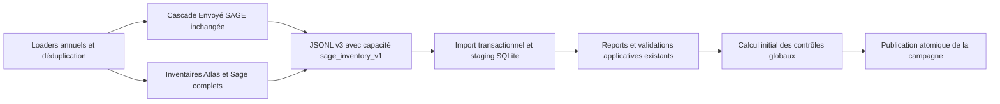

# Lot 1 Sage Atlas

## Audit et analyse d'écart avant implémentation

Branche `dev-feature-amelioration-rappro`, ancêtre `dev` vérifié, arbre propre.

| État | Mécanisme existant | Écart à traiter |
|---|---|---|
| Réutilisé | `loaders/sage.py:load_sage` : déduplication stricte avant typage et filtre annuel | conserver les charges décimales sources |
| Réutilisé | `loaders/atlas.py:load_atlas` : premier Id, conflits signalés | conserver le signal de conflit |
| Réutilisé | `matching/engine.py`, `matching/scope.py` : cascade et préfiltre Envoyé SAGE | aucun changement de cascade |
| Réutilisé | `reconciliation_contract:entry_from_sage`, `snapshot`, `compare` | règles v3 historiques inchangées |
| À adapter | `exporters/review.py:export_review_bundle` : flux et remplacement atomique | capacité explicite d'inventaire Sage complet, compteurs et empreinte du flux |
| À adapter | `campaigns.py:import_campaign`, `multiple_import.py` : lots, contrôles, publication transactionnelle | ordre et intégrité des enregistrements Sage |
| À créer | `CampaignInventory` ne conserve qu'Atlas ; `MultipleControl` ne couvre que les clés utiles | photographie Sage complète et calcul global indépendant |
| Réutilisé | `ControlContribution`, `review.py:is_current`, `CampaignReview` | ne compter que les affectations validées et actuelles |
| À adapter | `imports_app/sqlite_staging.py:STAGED` | transporter aussi les nouvelles photographies dans le staging |

Décisions conservatrices : aucune exclusion par défaut ; pas d'allocation partielle implicite ;
un groupe ODS de plusieurs lignes reste à revoir sans preuve d'unicité économique.
Les charges Sage sont celles de `Charges (Dépenses)` en EUR même lorsque la devise de
l'opération est étrangère (politique v3 existante). La devise Atlas doit être EUR ou
absente (colonnes de charges explicitement libellées en euros).

## Architecture livrée



`entry_from_sage` réutilise l'identité v3 : SHA256 de projet, exercice issu de
la date comptable, pièce, journal, ligne comptable et analytique. Les identifiants
restent des textes (`001` n'est pas `1`). `record_id` signe le contenu canonique
de l'écriture, les attributs comptables complémentaires et son empreinte source
avant typage ; `signature` signe également sa politique d'éligibilité.
Un record_id répété est refusé par contrainte SQL ; plusieurs contenus ayant la
même référence technique restent visibles mais rendent le contrôle indéterminé.
La déduplication stricte des lignes sources reste celle du loader.

Les loaders préservent les charges décimales dans des colonnes privées parallèles
aux colonnes historiques de matching. Les calculs d'inventaire utilisent Decimal.
Les preuves JSONL Sage exposent directement le montant décimal, sans colonne privée.
Les montants absents restent `null`, le zéro reste zéro et les signes sont conservés.
Les montants Sage ont au plus neuf décimales ; l'import refuse une précision supérieure
plutôt que de l'arrondir silencieusement. Atlas conserve la précision monétaire
historique de deux décimales. Le champ Atlas par défaut est `total_sage_charges`,
avec `--accounted-amount-field total_project_charges` disponible.

### Schéma additif

| Modèle | Données | Contraintes et index |
|---|---|---|
| `CampaignSageEntry` | campagne, record_id, ref, projet, exercice nullable, pièce, montant nullable, éligibilité, preuve JSON signée | unicité campagne/record_id ; index campagne/projet/exercice/pièce, campagne/control_key, campagne/ref, campagne/ods_scope |
| `CampaignGlobalControl` | calcul initial signé, état global, clé et projet | unicité campagne/clé ; index campagne/projet/état |
| `CampaignInventory` existant | ajout `ods_scope` vide pour les anciens fichiers | index campagne/ods_scope pour les compteurs bilatéraux |

Les autres attributs Sage (type de pièce, journal, lignes, tiers, libellé original,
date, devise, complétude, motif d'exclusion) sont conservés dans le JSON canonique.
Le montant SQL utilise `DecimalField(25,9)` ; les calculs lisent les chaînes
décimales du JSON, ce qui préserve également l'exactitude sous SQLite malgré ses
limites de stockage numérique. Les photographies sont consultables en lecture
seule dans l'administration. Les campagnes non publiées restent masquées.

## Contrat JSONL

Le numéro reste **3**, avec capacité obligatoire déclarée pour les nouvelles
sémantiques : `capabilities: ["sage_inventory_v1"]`. Les fichiers v1/v2/v3 sans
cette capacité suivent les règles historiques ; aucune réimportation n'est imposée.
Une capacité inconnue est refusée. La CLI active le lot 1 par défaut ;
`--legacy-review-output` permet de produire un v3 historique pour compatibilité.
L'API `export_review_bundle` conserve son comportement historique par défaut ;
passer `include_sage_inventory=True` active explicitement l'extension.

Ordre strict : en-tête → inventaire Atlas → inventaire Sage → propositions →
contrôles v3 → marqueur final. Les populations vides sont autorisées selon les
règles annuelles déjà existantes. Aucun enregistrement n'est accepté après la fin.

Extraits synthétiques (les empreintes ci-dessous sont abrégées pour la lecture) :

```json
{"type":"campaign","schema_version":3,"capabilities":["sage_inventory_v1"],"sage_exclusions":{"version":1,"prefixes":[],"signature":"…"}}
{"type":"sage_inventory","data":{"record_id":"…","source_fingerprint":"…","attributes":{"Référence":"B1"},"entry":{"ref":"…","project_code":"P","fiscal_year":2026,"document":"FAC123","journal":"ACH","line":"001","analytic_line":"01","amount":"6000.00"},"document_type":"FAC","control_key":"…","eligible":true,"exclusion_reason":"","signature":"…"}}
{"complete":1,"inventory_count":3,"sage_inventory_count":4,"control_count":3,"control_statuses":{"UNKNOWN":2,"SHORTFALL":1},"stream_sha256":"…"}
```

Utiliser `python -m examples.lot1_fixture <répertoire-temporaire>` pour obtenir
un exemple complet valide et ses signatures réelles. Les compteurs illustrés
ne remplacent pas ceux de cet exemple généré.

`stream_sha256` couvre tous les enregistrements avant le marqueur final : chaque
objet est sérialisé avec `json.dumps(ensure_ascii=False, allow_nan=False)` suivi
de LF, puis encodé UTF-8. L'import recalcule cette sérialisation normalisée
(indépendante des fins de ligne Windows). Cette empreinte détecte une altération ;
elle n'est pas une signature d'authenticité d'un émetteur. Les signatures métier,
compteurs, populations d'extraction, références, ordre et unicités sont vérifiés
en complément. Les contrôles v3 doivent correspondre exactement aux écritures
de leur clé dans l'inventaire complet, et respecter les exclusions.

L'export utilise un temporaire et `os.replace`, avec nettoyage en cas d'erreur.
L'import lit le fichier en flux et insère les inventaires par lots de 500.
Les preuves historiques v3 des propositions/contrôles sont conservées pour
compatibilité ; les nouveaux contrôles globaux ne recopient pas ces preuves,
ils référencent leurs identifiants et leurs contributeurs.

## Exclusions et règles de calcul

La configuration centralisée est `reconciliation/config.py:SAGE_EXCLUDED_PREFIXES`.
Elle est **vide par défaut**. Seuls des préfixes validés par le métier doivent y
être ajoutés, puis les nouvelles campagnes doivent être exportées. Aucun écran
de paramétrage existant adapté n'a été trouvé, donc pas de nouvelle interface.
Les préfixes ont trois caractères ASCII alphanumériques ; espaces externes et
casse sont normalisés, les valeurs invalides sont refusées. Une pièce absente
reste éligible mais son identité est incomplète.

La liste normalisée, la version et son SHA256 sont figés dans les métadonnées de
la campagne. Modifier la configuration ne réécrit aucune ancienne campagne.
Les écritures exclues restent dans l'inventaire ; leur groupe porte `EXCLU`.
Une exclusion partielle d'un groupe composite produit `INDETERMINE`.
Les contrôles v3 concernés portent un motif d'exclusion et restent `UNKNOWN`,
ce qui empêche les validations existantes de les utiliser.

* Standard : projet + exercice + pièce ; sommes individuelles signées, sans total
  de candidat répété. Les journaux incompatibles, montants absents, identités en
  collision, dates incohérentes ou données hors clé imposent `INDETERMINE`.
* ODS/ODG : projet + exercice + tiers + libellé normalisé, sans égalité des numéros
  intersources. Les contradictions préfixe/journal restent à revoir. La décision
  automatique exige un groupe économique un-pour-un. Sans libellé, les compteurs
  SQL vérifient en plus qu'aucun autre groupe du projet/exercice/tiers ne concurrence
  cette correspondance, dans aucune des deux populations. Plusieurs lignes de part
  et d'autre restent indéterminées : leur somme ne prouve pas l'unicité économique.
* Les contrôles v3 historiques conservent leur diagnostic ; le nouveau résultat
  versionné porte `accounted_state`, `state` et `auto_validated`. Cette dernière
  valeur concerne le rapprochement des sources déjà Comptabilisé et ne crée pas
  de décision Envoyé SAGE ni de nouvelle correction.
* La tolérance par défaut est inclusive à 0,01 EUR. Les signes mixtes restent
  à examiner. Un montant absent n'est jamais assimilé à zéro.

### Consolidation

`reconciliation_contract/sage_inventory.py:consolidate` réutilise `snapshot` et
`compare`, puis ajoute les affectations confirmées et leurs vérifications.
Le service Django `global_control.py:campaign_controls(campaign, keys=None)`
retourne les résultats en flux par lots de cent clés, avec lectures SQL par lot.
La mémoire dépend du nombre de lignes des groupes du lot, pas de l'inventaire entier.
Une pièce exceptionnellement volumineuse peut donc encore occuper beaucoup de mémoire.

Seules les `ControlContribution` liées à une décision `VALIDATED`, actuelle et
issue d'une source `Envoyé SAGE` contribuent. Pour la campagne courante, le service
recontrôle aussi l'état vivant et la signature applicative ; pour une campagne
close, il lit sa décision photographiée. La somme des affectations d'une ligne
doit égaler son montant effectif validé. Les références sont vérifiées dans
l'inventaire ; deux revendications d'une référence rendent le résultat indéterminé,
même si une dérogation métier ancienne les avait autorisées.

Une fraction d'une seule écriture peut être utilisée lorsqu'une décision manuelle
actuelle trace explicitement ligne, montant et référence : même signe et fraction
inférieure ou égale à l'écriture. Les fractions implicites, répartitions ambiguës,
preuves partagées et affectations ODS envoyées restent à revoir. Aucun nouveau
parcours d'affectation manuelle n'est ajouté.

Exemple : Sage FAC123 = 10000, Atlas Comptabilisé = 6000. Avant confirmation,
`accounted_gap = gap = -4000`, état `ECART`. Après affectation confirmée de 4000,
`accounted_gap = -4000`, `accounted_state = ECART`, `gap = 0`, `state = EQUILIBRE`.
Sans confirmation, ou après refus/péremption, le montant n'est pas ajouté.

`initialize_controls` photographie le calcul initial après reports et validations
automatiques existants, dans la transaction de publication. Un futur recalcul
ne remplace pas cette photographie. Pour un ancien fichier sans capacité, l'API
lève explicitement « Contrôle global indisponible pour cette campagne ».

## Migrations et exploitation

* `0015` crée les deux modèles Sage/global et leurs contraintes/index.
* `0016` ajoute les portées ODS indexées ; anciennes valeurs vides, sans backfill
  coûteux ni réimportation historique.
* `0017` restaure les triggers de révision SQLite, y compris sur les tables
  reconstruites par des migrations antérieures, et protège les nouveaux modèles.
  PostgreSQL n'a pas besoin de ces triggers : les verrous existants sont conservés.
* `0018` étend le montant Sage à `DecimalField(25,9)` : neuf décimales et
  toujours seize chiffres entiers, sans arrondir les données. Les triggers
  SQLite sont restaurés après l'altération du champ. Le JSONL existant n'a
  pas besoin d'être régénéré ni resigné : déployer le code, appliquer la
  migration, puis relancer l'import échoué. Ne pas revenir à six décimales
  après import de montants plus précis sans examiner la perte de précision.

Sur un environnement prévu pour la recette, sauvegarder la base puis exécuter
depuis `app-suivi-reconciliation` : `../.venv/Scripts/python.exe manage.py migrate`.
En SQLite sur disque, suivre également le circuit existant
`manage.py prepare_sqlite_imports --migrate`, sans worker actif.
Déployer et migrer l'application avant d'émettre les fichiers avec la nouvelle
capacité ; utiliser `--legacy-review-output` si le destinataire utilise encore
le code historique.
**Aucune migration de base applicative existante n'a été exécutée pendant le développement.**
Les tests migrent uniquement leurs bases jetables.

Les nouvelles tables font partie de `sqlite_staging.STAGED` : lots invisibles,
vérification de révision et publication atomique restent le même mécanisme.
Un fichier tronqué, contradictoire, dupliqué ou altéré annule l'import parent.
L'ancienne campagne courante et ses décisions restent intactes.

Rollback prudent : arrêter les workers, sauvegarder, revenir au code antérieur
en laissant les tables additives en place (approche privilégiée). Ne supprimer
les migrations 0015–0017 qu'après export/sauvegarde des nouvelles photographies
et acceptation explicite de leur perte ; conserver les protections de concurrence.
Aucun changement de données de production, push ou merge n'est réalisé ici.

## Recette et traçabilité

| Exigence | Fonction/fichier | Preuve automatique |
|---|---|---|
| Inventaire complet hors candidats et déduplication | `reconciliation/sage_inventory.py:inventory_records`, loaders Sage | `test_full_inventory_export_and_atomic_failure`, `test_inventory_signatures_and_decimal_source` |
| Exclusions strictes, conservées et historiques | `exclusion_policy`, `sage_import.py`, `multiple_import.py` | `test_invalid_policies`, `test_excluded_entries_and_missing_documents_are_preserved`, `test_policy_history_and_old_campaign_unavailable` |
| Standard, sommes, tolérance, signes, identités | `consolidate` | `test_standard_tolerance_and_missing_amounts`, `test_individual_sums_and_negative_amounts`, `test_collisions_multiple_journals_and_scope_mismatches` |
| ODS avec/sans libellé, unicité économique et bilatérale | `consolidate`, `ods_scope`, `campaign_controls` | `test_ods_unique_group_with_or_without_label`, `test_ods_amount_mismatch_and_prefix_journal_disagreement`, `test_label_absent_with_other_label_is_not_unique` |
| Comptabilisé + Envoyé confirmé | `campaign_controls`, `initialize_controls` | `test_inventory_initial_ods_and_confirmed_mix`, `test_confirmed_allocation_balances_without_losing_initial_gap` |
| Propositions/refus/péremption ignorés et pas de double comptage | `consolidate`, `ControlContribution` existant | `test_confirmed_allocation_balances_without_losing_initial_gap`, `test_partial_allocation_requires_explicit_validated_trace` |
| JSONL intègre et rollback | `export_review_bundle`, `import_campaign`, `insert_sage_batch` | `test_corruption_order_truncation_and_duplicate_rollback` |
| Historique v2/v3 et cascade inchangés | `review_import`, contrôles existants | suites existantes moteur/Django, `test_unknown_policy_blocks_without_bypassing_and_historical_v2_remains_readable` |
| Staging, concurrence et migration à blanc | `sqlite_staging`, migrations 0015–0017 | `test_lot1_inventory_and_controls_survive_staging`, `test_concurrent_decision_prevents_publication`, bases de test migrées neuves |
| Lots/index et volume | `campaign_controls`, index modèles, `benchmark_lot1` | `test_batched_calculation_queries_and_sql_indexes`, benchmark synthétique 10000 pièces |

Scénarios métier Given/When/Then :

1. **Standard** — Given plusieurs lignes Sage d'une même pièce et des charges
   Atlas individuelles ; When les sommes complètes coïncident dans la tolérance ;
   Then le contrôle Comptabilisé est équilibré si les identités et journaux sont fiables.
2. **ODS sans libellé** — Given un unique couple projet/exercice/tiers de chaque
   côté, sans libellé et à montant égal ; When le contrôle s'exécute ; Then
   `auto_validated=true`. Avec un candidat concurrent, Then `INDETERMINE`.
3. **Exclusions** — Given une politique validée contenant un préfixe ; When une
   nouvelle campagne est importée ; Then les écritures restent présentes avec
   leur motif, les groupes exclus portent `EXCLU`, l'historique demeure inchangé.
4. **Mixte** — Given 10000 Sage, 6000 Comptabilisé et une proposition de 4000 ;
   When aucune confirmation n'existe ; Then écart -4000. When l'affectation est
   confirmée et actuelle ; Then écart global zéro et écart initial -4000 conservé.
5. **Double preuve** — Given deux validations revendiquant la même écriture ;
   When le contrôle global est demandé ; Then `INDETERMINE`, jamais un faux équilibre.

## Lot 2 et limites

Le point d'appel destiné au lot 2 est `campaign_controls(campaign, keys=[...])`,
sous verrou de campagne dans la transaction de validation/correction. Le lot 2
pourra matérialiser séparément un résultat courant et exposer une synthèse ; le
calcul initial doit rester intact. Aucun déclencheur systématique, écran de
correction de montants, motif doublon, nouveau rapprochement manuel ou processus
permanent n'est développé dans ce lot.

Les verrous/requêtes PostgreSQL restent à qualifier sur une instance dédiée ;
les tests de concurrence PostgreSQL sont ignorés lorsque SQLite est utilisé.
Le benchmark synthétique ne reproduit pas toute la distribution d'une extraction
réelle ni le coût historique des imports de propositions. Les écritures avec une
identité ou une précision non prise en charge exigent revue/correction de source.

## Fichiers livrés et analyse d'impact

Créations :

* `reconciliation_contract/sage_inventory.py` : politique signée, photographie,
  validation canonique, portée ODS et consolidation pure réutilisant le contrat.
* `reconciliation/sage_inventory.py` : parcours pandas complet.
* `app-suivi-reconciliation/reconciliation/sage_import.py` : validation des
  capacités et insertions par lots.
* `app-suivi-reconciliation/reconciliation/global_control.py` : calcul Django
  en flux et photographie initiale.
* `app-suivi-reconciliation/reconciliation/migrations/0015_campaignglobalcontrol_campaignsageentry.py`.
* `app-suivi-reconciliation/reconciliation/migrations/0016_campaigninventory_ods_scope_and_more.py`.
* `app-suivi-reconciliation/reconciliation/migrations/0017_restore_import_revision_triggers.py`.
* `tests/test_sage_inventory.py` et
  `app-suivi-reconciliation/reconciliation/test_sage_inventory.py` : recette dédiée.
* `examples/lot1_fixture.py` et `examples/benchmark_lot1.py` : fixtures et mesure isolées.
* `docs/lot1_sage_atlas.md` : audit, architecture, recette et compte rendu.

Modifications :

* `reconciliation/config.py`, `loaders/sage.py`, `loaders/atlas.py` : exclusions
  centralisées et préservation des décimales/empreintes, sans changer les valeurs
  historiques de la cascade.
* `reconciliation_contract/__init__.py:entry_from_sage` : réutilisation des
  décimales sources lorsqu'elles sont présentes ; anciens fichiers compatibles.
* `reconciliation/exporters/review.py`, `reconciliation/main.py`,
  `reconciliation/multiples.py` : capacité explicite, flux d'inventaire signé,
  montants exacts et exclusions des contrôles.
* `app-suivi-reconciliation/reconciliation/models.py`, `campaigns.py`,
  `multiple_import.py`, `admin.py` : schéma additif, intégration atomique,
  concordance des preuves et consultation technique.
* `app-suivi-reconciliation/imports_app/sqlite_staging.py` : nouvelles tables
  dans les lots invisibles, sans nouveau mécanisme d'import.
* `examples/multiples_fixture.py`, `tests/test_auto_validation.py`,
  `tests/test_review_bundle.py`, `tests/test_input_regressions.py`,
  `app-suivi-reconciliation/reconciliation/test_multiples.py`,
  `app-suivi-reconciliation/imports_app/sqlite_scenarios.py` : fixtures historiques
  explicitement v2/v3, compatibilité d'activation, colonne privée décimale et
  distinction entre nouveau fichier et réimport idempotent ; ajout de la recette
  de staging du lot 1. Les assertions de sécurité métier sont conservées.

Avant : preuves Sage limitées aux candidats et clés utiles, absence de photographie
globale, aucun calcul exploitable pour toutes les pièces non proposées. Après :
chaque source Sage distincte est conservée, exclusions historiques interprétables,
contrôle initial et API de recalcul ciblé disponibles. Les décisions, règles de
cascade et écrans métier restent ceux du socle ; seule la consultation admin
des nouvelles photographies est ajoutée.

## Vérifications exécutées

Commandes Windows, avec l'environnement Python déjà installé dans `.venv` :

| Répertoire | Commande | Résultat |
|---|---|---|
| Racine | `.venv/Scripts/python.exe -m pytest -q` | 181 réussis, 1 ignoré |
| `app-suivi-reconciliation` | `../.venv/Scripts/python.exe manage.py test --noinput --verbosity 0` | 196 tests, OK, 2 ignorés |
| `app-suivi-reconciliation` | `../.venv/Scripts/python.exe manage.py test reconciliation.test_sage_inventory reconciliation.test_multiples imports_app.test_sqlite_staging --noinput --verbosity 0` | 21 tests, OK, 1 ignoré ; le test de staging exécute aussi neuf scénarios isolés sur disque |
| Racine | `.venv/Scripts/python.exe app-suivi-reconciliation/manage.py makemigrations --check --dry-run` | aucun changement de modèle non migré |
| Racine | `git diff --check` | aucune erreur d'espaces ; avertissements Git LF/CRLF selon la configuration Windows |
| Racine | `.venv/Scripts/python.exe -m examples.benchmark_lot1 10000` | 10000 écritures et 10000 contrôles importés ; export 1,295 s, import 18,109 s, JSONL 8,728 Mio, pic Python d'import 24,790 Mio |

Les migrations 0015–0017 sont exécutées à blanc par les bases de test neuves,
y compris les bases SQLite sur disque des tests de staging. L'introspection
des quatre index Sage est vérifiée par test. La limite de requêtes du calcul
par lot est également vérifiée ; le benchmark utilise une base temporaire.

Le test moteur sur données métier réelles est ignoré car son activation explicite
`RECONCILIATION_REAL_TESTS=1` n'a pas été demandée. Les deux tests Django de
verrouillage PostgreSQL sont ignorés sous SQLite. Aucun plan EXPLAIN ni mesure
de verrous PostgreSQL n'est présenté comme validé.

Avertissement Django observé : répertoire `staticfiles` absent dans cet
environnement de tests ; aucune incidence sur les assertions backend.
Les premiers passages ont révélé des fixtures v2 incompatibles avec le mode
collectif ACTIVE et des scénarios supposant qu'un réimport identique crée une
campagne ; les fixtures ont été rendues explicites sans relâcher les contrôles.
Le scénario réel de concurrence a en outre mis en évidence les triggers SQLite
manquants après reconstruction de tables : la migration 0017 les restaure, et
ce scénario passe désormais.

### Extension à neuf décimales — 3 novembre 2026

L'import de `data/outputs/campagne_03112026.jsonl` révélait 18 montants Sage
dépassant six décimales (16 à huit décimales, 2 à neuf). La validation admet
désormais neuf décimales ; `0018_alter_campaignsageentry_amount` fait évoluer
le champ SQL de `(22,6)` à `(25,9)`, sans réduire sa capacité entière ni modifier
les signatures ou les montants du JSONL. Les valeurs dépassant neuf décimales
restent refusées. Aucun arrondi/tronquage n'est introduit.

Les tests dédiés couvrent les montants négatifs à huit décimales, les valeurs
à neuf décimales et la notation scientifique équivalente, les fichiers à six
décimales, la conservation des seize chiffres entiers, les absences et le refus
de dix décimales. Le test d'import vérifie les valeurs JSON/SQL et le calcul
global, ainsi que les triggers SQLite après migration.

Déploiement : appliquer `python manage.py migrate` depuis l'application avec
le nouvel environnement, puis relancer l'import du **même JSONL**. La base
applicative existante n'a pas été migrée pendant ce correctif ; seuls les schémas
des bases de test jetables ont été modifiés. La modification locale préexistante
de `README.md` est conservée.

Résultats du correctif : `.venv/Scripts/python.exe -m pytest -q` → **188 réussis,
1 ignoré** ; depuis l'application, `../.venv/Scripts/python.exe manage.py test
--noinput --verbosity 0` → **197 tests, OK, 2 ignorés** (PostgreSQL non disponible).
`makemigrations --check --dry-run` ne détecte aucun écart ; `git diff --check`
ne détecte aucune erreur d'espaces. L'avertissement `staticfiles` absent reste
identique à la recette précédente. Une lecture complète du JSONL concerné
avec `validate_inventory_record` valide les **487334 écritures Sage**, y compris
les 18 montants auparavant rejetés, sans aucune erreur de validation d'inventaire.
Ce contrôle ne constitue pas un import complet en base et ne modifie pas le fichier.
