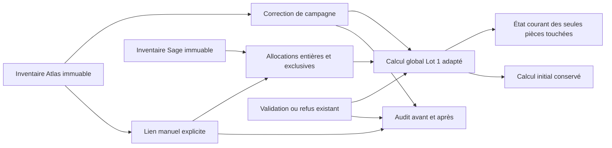

# Lot 2 : corrections, recherche Sage et recalcul ciblé

## Audit initial (avant modification)

Branche `dev-feature-lot2-validations-manuelles`, issue de `dev`, arbre propre.
Le Lot 1 est présent : `CampaignInventory`, `CampaignSageEntry`,
`CampaignGlobalControl`, `global_control.campaign_controls`, contrat v3 déclaré
et import atomique/staging. Les correctifs A/B sont présents et vérifiés :
référence `total_sage_charges` des Confirmé, affichage dans Données sources,
`automatic_blockers`, `exact_entry` et `compatible_exact_peer`.

| État | Composant réel | Adaptation prévue |
|---|---|---|
| Réutiliser | `review.decide`, `ReviewEvent`, versions, verrous Campaign/ReviewGroup | recalcul après action effective, préserver autorisations et auto-validations |
| Réutiliser | `CampaignInventory` et `CampaignSageEntry` immuables | ancrage exact des corrections/liens dans une campagne |
| À adapter | `global_control.campaign_controls` et `CampaignGlobalControl` | intégrer les montants retenus/liens manuels, stocker le résultat courant à côté du calcul initial |
| À créer | correction de montant ou doublon | objet dédié, motif centralisé, montant Decimal, version et audit |
| À créer | recherche indépendante des candidats moteur | inventaire Sage filtré projet/campagne/exercice/éligibilité, sélection et confirmation explicites |
| À créer | affectations manuelles d'inventaire | références réelles, consommation intégrale et exclusive, annulation logique |
| À adapter | détail de revue et inventaire de campagne | deux actions Corriger/Rechercher, détail des sources/valeurs retenues et historique |
| À adapter | reprise de campagne et staging SQLite | aucune reprise implicite des nouveaux liens/corrections ; révision des nouveaux modèles |

Choix conservateurs : pas d'affectation partielle implicite ; seules des écritures
entières, identifiables et dont la somme explique le montant retenu dans la
tolérance peuvent être confirmées. La pièce partagée reste permise si la capacité
globale et les références distinctes sont démontrées. Les charges comparées sont
en EUR selon le Lot 1, indépendamment de la devise d'origine Sage.

## Architecture livrée

Le contrat JSONL et la cascade moteur ne changent pas. L'initialisation d'import
utilise toujours le calcul complet Lot 1 une fois ; les auto-validations initiales
suspendent le hook ciblé avec un ContextVar strictement limité à cet appel.
Une action ultérieure appelle le calcul ciblé dans la transaction de décision.

### Modèles et migration additive 0020

| Objet | Rôle et contraintes |
|---|---|
| `AtlasAdjustment` | OneToOne vers la ligne exacte `CampaignInventory` ; motif AMOUNT/DUPLICATE, montant EUR Decimal(18,2) nullable pour doublon, active, version, auteur/date/commentaire |
| `ManualReconciliation` | OneToOne vers la même ligne de campagne ; confirmation manuelle, montant retenu, version de correction au moment de confirmer, auteur/date/commentaire et annulation logique |
| `ManualAllocation` | lien vers une écriture réelle `CampaignSageEntry`, montant Decimal(25,9) intégral, active ; contrainte unique partielle sur l'écriture tant qu'elle est active |
| `CampaignAction` | audit append-only avant/après, contrôles chiffrés/signatures, auteur/date, UUID unique et empreinte de requête pour l'idempotence |
| `CampaignInventory.business_version` | verrou optimiste commun aux actions de correction, lien et décision sur cette ligne |
| `LineReview.inventory_link`, `adjustment_version` | provenance/base de la projection de revue, sans modifier les preuves moteur |
| `CampaignGlobalControl.current_data/current_version/current_updated_at` | résultat courant et version ; `data`/`state` initiaux restent ceux de l'import |

Les relations OneToOne et ForeignKey fournissent les index des accès ciblés.
La contrainte `one_active_manual_entry` interdit deux réservations manuelles
actives de la même écriture. Les références v3 en collision sont refusées par
le service : le seul triplet projet/pièce/date n'est jamais utilisé comme unicité.
Le verrou Campaign commun protège aussi les collisions entre anciens
`ControlContribution` et nouvelles allocations d'inventaire.

La migration restaure les triggers SQLite après reconstruction des tables et
étend le compteur de révision aux quatre nouvelles tables. PostgreSQL utilise
ses transactions/verrous et la contrainte d'unicité. Les nouvelles actions ne
sont pas produites par l'import : le staging copie les nouvelles colonnes des
tables existantes, conserve les anciens objets métier et ne les propage pas
dans une nouvelle campagne. Une action concurrente invalide sa copie préparée.

## Règles financières

* **Source** : `data` d'inventaire reste intact. Comptabilisé utilise le champ
  configuré de campagne (charges Sage par défaut) ; Confirmé dans Atlas utilise
  les charges Sage Atlas, et les autres Envoyé les charges projet.
* **Montant erroné** : montant obligatoire, fini, à deux décimales et de même
  signe que la source lorsqu'il est connu. Une absence de source n'est pas
  convertie en zéro. Aucune correction n'est exportée comme validée par sa seule création.
* **Doublon** : exclusion explicite du calcul, retenu zéro, sans suppression de
  la ligne ni changement du montant source. Le zéro source reste un cas distinct.
* Modifier/annuler une correction conserve l'objet et incrémente sa version.
  Une décision touchée conserve son état/auteur/origine mais devient périmée,
  empêche un export comme décision actuelle et exige une nouvelle confirmation.
* **Lien manuel** : sélection d'écritures entières, dans le même projet/campagne/
  exercice, éligibles selon les exclusions figées. Le statut Atlas doit être
  Comptabilisé ou Envoyé SAGE. Aucun candidat moteur n'est requis.
* Les charges Sage sont EUR selon la politique Lot 1, même si la devise de
  l'opération Sage est étrangère. Atlas accepte EUR et sa désignation
  `EUR - Euro` ; une devise incompatible reste à revoir.
* Les montants Sage gardent neuf décimales ; les calculs lisent leurs chaînes
  exactes et utilisent Decimal, y compris sous SQLite. L'affichage réutilise
  le filtre `euros` à deux décimales. Une somme sélectionnée doit expliquer le
  retenu dans la tolérance de campagne (0,01 EUR par défaut). Chaque écriture est
  consommée intégralement ; le récapitulatif expose l'écart, sans inventer une fraction.
* Les signes mixtes, identités absentes/collisions, sources hors périmètre,
  preuves déjà consommées et dépassements sont refusés. Une pièce partagée à
  références distinctes reste possible. Les actions via l'ancien formulaire
  sont également contrôlées contre les réservations et la capacité courante
  pour les campagnes disposant de l'inventaire Lot 1.
* Un lien actif modifié/corrigé n'est pas silencieusement reconfirmé. Son
  remplacement exige une confirmation explicite et un commentaire. L'annulation
  libère les allocations sans effacer les événements et rouvre la revue.

### ODS/ODG

L'automatique Lot 1 est inchangé : composite projet/exercice/tiers/libellé,
un-pour-un économique, libellé absent accepté si unicité bilatérale et montants
concordants. Le nouveau parcours peut confirmer explicitement des références
ODS multiples, entières et identifiées. Leur projection utilise la clé composite
Sage cible avec une provenance manuelle, sans changer la pièce/tiers/libellé source
Atlas. Les sources Comptabilisé réaffectées sont retirées de l'ancien groupe de
calcul et comptées une seule fois sur les groupes explicitement choisis.

Le calcul ne relâche l'unicité automatique ODS qu'en présence d'une confirmation
manuelle actuelle couvrant les sources/allocations du groupe. `auto_validated`
reste False dès qu'une provenance métier Lot 2 participe au résultat. Un équilibre
financier après correction ne crée jamais une nouvelle décision AUTO.

## Parcours et permissions

Depuis le détail d'une revue, les deux actions ajoutées sont **Corriger** et
**Rechercher une correspondance**. Dans l'inventaire de campagne, l'Id Atlas ouvre
le même détail métier, y compris pour les Comptabilisé sans `LineReview`.

Le détail montre source de référence, charges projet et Sage sources, retenu,
écart de correction, motif, auteur et date. Le formulaire Corriger reste court.
La recherche comporte quatre filtres facultatifs (pièce, tiers, montant, libellé),
une pagination de 25 résultats et la disponibilité/affectation de chaque pièce.
Le récapitulatif expose les sommes, existants Comptabilisé/confirmés, solde,
écart et alertes avant confirmation. Une sélection ou recherche n'écrit rien.

La confirmation conserve la règle/preuve moteur d'origine ; `LineReview` est
une projection MANUAL et le `ReviewEvent` porte `INVENTORY_MANUAL`. L'export de
campagne réutilise sa colonne d'affectation manuelle pour les cibles réelles,
issues du snapshot et non d'une preuve moteur fabriquée. Les anciens exports
restent compatibles pour les décisions qui n'utilisent pas le Lot 2.

Le détail affiche les contrôles actualisés et le diagnostic initial conservé,
ainsi qu'un historique métier paginé. Les cibles avant/après sont lisibles sans
SHA ou JSON affiché. Les objets source et les événements passés ne sont pas supprimés.

Les droits réutilisent le portefeuille `projects_for`/`inventory_for`. Ils sont
revérifiés dans les services, avec utilisateur actif/authentifié. Aucun résultat
d'un autre projet/campagne/exercice ni écriture exclue n'est sélectionnable via
un POST fabriqué. Les campagnes closes, non publiées et lignes absentes sont
verrouillées en écriture ; l'historique publié autorisé reste consultable.

## Recalcul, concurrence et reprise

`affected_keys` capture les clés de source et les cibles **avant et après**
l'action. `recalculate` appelle `campaign_controls(campaign, keys=...)`, sans
recalculer le portefeuille. Les contrôles sont verrouillés en ordre de clé et
le contenu identique n'incrémente pas leur version. Les lectures/GET/prévisualisations
ne déclenchent aucun calcul ni confirmation.

`business_inputs` adapte en mémoire les entrées du calcul Lot 1 : corrections,
exclusions, confirmations périmées, liens explicites et contributions complètes.
Les décisions photographiées de la campagne servent aux contrôles historiques,
pas les valeurs mutables d'une revue passée depuis dans une autre campagne.
Chaque écriture Sage de référence est comptée une fois ; les montants de
propositions moteur répétés ne sont pas ajoutés.

Les déclencheurs sont : correction/modification/annulation, confirmation/remplacement/
annulation de lien, décision/refus/réouverture existants et auto-validation
applicative hors import initial. L'opération, les réservations, le résultat
courant et l'audit sont dans le même `transaction.atomic`. La campagne est
verrouillée avant la ligne ; la version optimiste refuse une page périmée et
l'UUID unique rend le même POST idempotent. Un UUID réutilisé avec un autre
contenu est refusé. Les confirmations concurrentes incompatibles ne peuvent pas
publier deux consommations ; les erreurs invitent à actualiser.

Les callbacks de l'import sont suspendus uniquement pendant ses validations
initiales, puis le calcul initial complet existant est exécuté. Les corrections
et liens ne sont **jamais reportés implicitement** : nouvelles lignes d'inventaire
sans objets métier, revue antérieure nécessitant confirmation, y compris si le
moteur réémet une autorisation AUTO. Les anciennes photographies restent intactes.
Un réimport des mêmes octets garde son idempotence historique et ne réévalue pas
en masse les décisions.

## Exemples de recette Given/When/Then

1. **Montant** — Given Atlas Comptabilisé 15000 et Sage 10000 ; When correction
   Montant erroné à 10000 ; Then source 15000, retenu 10000, écart de correction
   -5000 et contrôle équilibré sans nouvelle confirmation. When annulation ;
   Then retenu 15000 et écart global 5000 restaurés.
2. **Doublon** — Given deux Atlas de 10000 et Sage 10000 ; When l'un est marqué
   Doublon ; Then ses sources restent visibles, retenu zéro, une seule charge
   contribue et aucune écriture n'est réservée par la simple correction.
3. **Mixte** — Given FAC123, Sage 10000, Comptabilisé 6000 et Envoyé proposé
   4000 sans pièce source ; When confirmation de l'écriture réelle 4000 ; Then
   écart global zéro, écart Comptabilisé seul -4000 conservé. When annulation
   ou refus ; Then retour à -4000. L'UI explicite la convention signée Atlas − Sage.
4. **Sans candidat** — Given une revue UNMATCHED ; When recherche dans le même
   inventaire Sage puis sélection fiable ; Then origine MANUAL, preuve moteur
   inchangée, cibles et auteur/date historisés, contrôle recalculé.
5. **Transfert** — Given un lien confirmé sur FAC123 ; When remplacement explicite
   vers FAC456 ; Then les deux pièces sont réévaluées, l'ancienne réservation
   est libérée et l'historique conserve les cibles avant/après.
6. **Conflit** — Given deux lignes visant la même écriture ; When confirmations
   concurrentes ; Then une seule peut réserver cette écriture, l'autre reçoit
   un refus métier. Changer l'UUID ou contourner les cases du formulaire ne suffit pas.
7. **Correction après validation** — Given une décision actuelle ; When son
   retenu est modifié ; Then elle devient à revoir, sans perdre son état/auteur
   historique et sans être exportée comme actuelle. Une nouvelle confirmation
   explicite est nécessaire même après retour à la valeur source.

## Matrice de traçabilité

| Exigence | Implémentation | Tests / vérification |
|---|---|---|
| Corrections et annulation | `correct_inventory`, `retained_amount`, AtlasAdjustment | `test_correct_amount_15000_to_10000_then_cancel` |
| Doublon | même service, `business_inputs` | `test_duplicate_excludes_only_one_source_without_deleting_it` |
| Validation, signe, précision, droits/version | formulaires, `_locked_inventory`, `_request` | `test_wrong_sign_precision_reason_and_partial_selection_are_rejected`, `test_permissions_closed_campaign_and_optimistic_version` |
| Recherche sans candidat | `search_sage`, `selection_summary`, confirmation | `test_no_engine_candidate_needed_for_manual_confirmation` |
| Périmètre sécurisé | filtres serveur, référence univoque | `test_excluded_other_scope_and_reserved_entries_cannot_be_selected`, `test_other_campaign_project_and_exercise_are_not_searchable` |
| Mixte et annulation | calcul ciblé Lot 1 + liens | `test_reference_confirm_cancel_keeps_initial_control_and_sources`, `test_legacy_decision_confirm_refuse_recalculates_old_target` |
| Correction non validante | bases versionnées, invalidation de fraîcheur | `test_correction_is_not_a_confirmation_and_requires_new_link_basis`, `test_correction_invalidates_export_freshness_without_overwriting_decision` |
| Plusieurs écritures / pas de total répété | ManualAllocation, `business_inputs` | `test_one_atlas_to_several_whole_entries_counts_each_once` |
| ODS auto conservé / manuel composite | `consolidate(manual_ods=False)` par défaut, projection manuelle explicite | `test_manual_ods_keeps_composite_identity_and_lot1_auto_rule`, `test_multiple_ods_candidates_can_be_resolved_by_explicit_whole_selection` |
| Régressions A/B | services existants préservés + gardes de reprise | suites `test_autovalidation_correctif`, `test_collective_validation`, `test_auto_validation` |
| Non-double consommation | verrou Campaign, contrainte active, `_assert_capacity` | `test_same_entry_cannot_be_confirmed_by_another_line`, `test_legacy_validation_cannot_bypass_inventory_capacity_with_a_comment` |
| Concurrence PostgreSQL | transactions / réservation unique | `BusinessConcurrencyTests.test_only_one_conflicting_confirmation_can_commit` (PostgreSQL requis) |
| Transfert | clés avant/après | `test_transfer_recalculates_both_old_and_new_piece` |
| Idempotence | UUID + empreinte de requête | `test_retries_are_idempotent_and_request_ids_cannot_change_payload` |
| Historique/reprise | snapshots, refus de reprise implicite | `test_new_campaign_does_not_carry_manual_link_or_correction`, `test_corrected_auto_is_not_automatically_reactivated_in_next_campaign` |
| UI, absence d'effet en recherche | vues/formulaires/templates | `test_ui_preview_has_no_side_effects_and_formats_amounts`, `test_form_post_correction_and_confirmation_are_audited` |
| Exports | snapshot allocations dans export campagne | `test_manual_export_contains_actual_inventory_allocations` |
| Historique sans inventaire Sage | capacité explicitement vérifiée | `test_old_campaign_without_sage_inventory_displays_unavailable` |
| Coût borné | clés explicites, index existants, lectures par lot | `test_recalculation_is_targeted_and_idempotent`, `test_large_unrelated_inventory_does_not_expand_confirmation_queries` (2000 écritures, moins de 90 requêtes, au plus 2 clés) |
| Publication et actions concurrentes SQLite | triggers nouveaux modèles, copie révisée existante | `sqlite_scenarios.test_lot2_correction_prevents_publication_of_a_stale_import` |

## Fichiers et documentation du code

Créations : `business.py` (services, audit, idempotence et hooks),
`business_calculation.py` (projection pure des données métier par lot),
`business_forms.py`, `business_views.py`, `templates/reconciliation/inventory_detail.html`,
`migrations/0020_lot2_business_actions.py`, `test_business.py`,
`test_business_concurrency.py` et ce document.

Adaptations : `models.py`, `global_control.py`, `campaigns.py`, `review.py`,
`multiple_review.py`, `auto_validation.py`, `collective_validation.py`,
`review_views.py`, `campaign_views.py`, `urls.py`, `templatetags/review_ui.py`,
templates `campaign.html`/`review_detail.html`, `imports_app/sqlite_scenarios.py`
et contrat pur `reconciliation_contract/sage_inventory.py`.
Les chemins Django sont relatifs à `app-suivi-reconciliation/reconciliation`
sauf indication explicite. Aucun changement de moteur, de configuration de
connexion PostgreSQL ou de manifest de déploiement.

Les fonctions/classes nouvelles et modifiées ont des docstrings françaises
(rôle, paramètres, retours, effets transactionnels, exceptions, montants et
unicité lorsque concernés). Un inventaire AST du diff compare aussi les
définitions avec HEAD pour détecter les docstrings absentes, y compris helpers
et classes Meta.

## Vérifications exécutées le 6 novembre 2026

- Contrat et moteur Python : `.venv/Scripts/python.exe -m pytest -q` —
  **192 tests réussis, 1 ignoré** (test sur données réelles à activer explicitement).
- Application Django : `python manage.py test --noinput --verbosity 0` —
  **246 tests, succès, 3 ignorés**. Les trois tests de concurrence nécessitent
  PostgreSQL ; ils n'ont pas été exécutés dans cet environnement SQLite.
- Dernière vérification ciblée : `python manage.py test
  imports_app.test_sqlite_staging --noinput --verbosity 0` — succès après ajout
  des assertions de non-reprise d'un rapprochement manuel dans la campagne suivante.
- Les **26 tests métier Lot 2** passent, dont le contrôle de volume avec
  2 000 écritures supplémentaires : moins de 90 requêtes SQL et au plus deux
  clés de contrôle recalculées pour l'action testée.
- `python manage.py makemigrations --check --dry-run` : aucune migration
  manquante. `git diff --check` : aucune erreur d'espacement.
- L'[inventaire des docstrings](lot2_docstrings_inventory.md) couvre
  **98 définitions nouvelles ou modifiées**, sans docstring manquante.

Les migrations et imports de test utilisent des bases jetables. La concurrence
réelle et les performances PostgreSQL restent à vérifier en recette dédiée.

## Déploiement et limites

Déployer l'application puis appliquer `python manage.py migrate` dans
l'environnement de recette. En SQLite sur disque, utiliser le circuit existant
`prepare_sqlite_imports --migrate`, hors worker actif. Les tests migrent uniquement
leurs bases jetables ; aucune migration de la base applicative existante n'est
exécutée pendant le développement.

L'historique demeure consultable sans réimportation. Un nouveau fichier source
n'emporte aucune correction locale. Les affectations partielles nouvelles restent
à revoir : pas d'éditeur de fractions/graphe, pas de réécriture Atlas/Sage, pas de
Celery/Redis ni de tâche permanente. Les règles historiques de fichiers sans
inventaire Sage restent consultables mais ne fournissent pas de faux contrôle global.

La taille mémoire dépend des groupes ciblés : une pièce exceptionnellement
volumineuse peut encore être coûteuse. La recherche par libellé utilise des filtres
SQL dans le projet autorisé, pas une recherche fuzzy globale. Les performances
de production et plans EXPLAIN PostgreSQL restent à mesurer sur une base dédiée.

Rollback : sauvegarder et suspendre les écritures avant toute intervention.
Ne pas supprimer les tables Lot 2 ni rétrécir le schéma sans exporter leurs
corrections/liens/audits. Une ancienne application ignorant les réservations
Lot 2 ne doit pas être remise en écriture sans stratégie explicite de reprise
ou restauration de sauvegarde. Le Lot 3 pourra lire `current_data` (ou `data`
si aucun changement), ses versions et la provenance ; aucune synthèse financière
par projet n'est implémentée ici.
